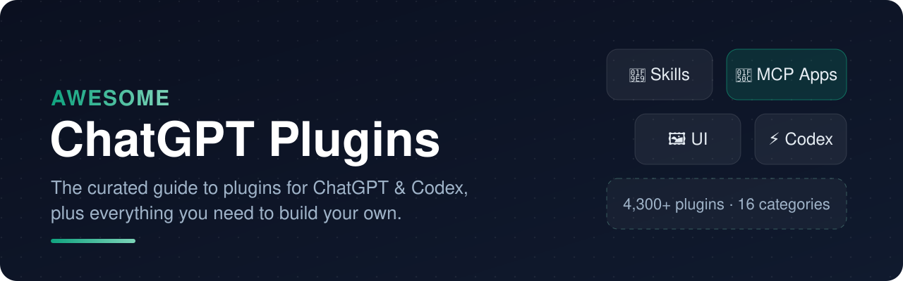
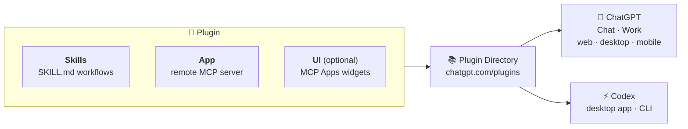

**[Start here](#-start-here)** · **[Browse by category](#-plugins-by-category)** · **[Full catalog (4,338)](catalog/README.md)** · **[Build a plugin](#%EF%B8%8F-build-your-own-plugin)** · **[Contribute](CONTRIBUTING.md)**

This repo has three layers:

- 🌟 **719 hand-picked plugins** in 28 categories, chosen from 4,338 listings in the official directory (below).
- 📚 **A [full, searchable catalog](catalog/README.md)** of every plugin in the directory, plus [JSON](data/plugins.json) and [CSV](data/plugins.csv) exports and a list of [public MCP endpoints](catalog/mcp-endpoints.md).
- 🛠️ **A builder's toolkit:** official docs, SDKs, frameworks, testing tools, templates, and a [submission checklist](docs/building-plugins.md).

## Contents

<b>Expand table of contents</b>

- [🧠 What are ChatGPT plugins?](#-what-are-chatgpt-plugins)
- [🚀 Start here](#-start-here)
- [🧭 Plugins by category](#-plugins-by-category)
  - [💠 Built by OpenAI](#-built-by-openai)
  - [💻 Coding & Software Engineering](#-coding--software-engineering)
  - [☁️ Cloud, Deploy & Databases](#%EF%B8%8F-cloud-deploy--databases)
  - [🔎 Web Search, Scraping & Browsing](#-web-search-scraping--browsing)
  - [🤖 Automation, Agents & Integrations](#-automation-agents--integrations)
  - [🎨 Design, Whiteboards & UI](#-design-whiteboards--ui)
  - [🎬 Image, Video, Audio & Music Creation](#-image-video-audio--music-creation)
  - [✍️ Writing, Publishing & Websites](#%EF%B8%8F-writing-publishing--websites)
  - [📝 Docs, Notes & Knowledge](#-docs-notes--knowledge)
  - [✅ Project & Task Management](#-project--task-management)
  - [📅 Meetings, Calendar & Scheduling](#-meetings-calendar--scheduling)
  - [💬 Email & Team Chat](#-email--team-chat)
  - [🤝 Sales, CRM & Customer Support](#-sales-crm--customer-support)
  - [📣 Marketing, SEO & Social Media](#-marketing-seo--social-media)
  - [🛍️ E-commerce & Shopping](#%EF%B8%8F-e-commerce--shopping)
  - [💳 Payments, Accounting & Payroll](#-payments-accounting--payroll)
  - [📈 Investing, Markets & Personal Finance](#-investing-markets--personal-finance)
  - [📊 Data, Analytics & BI](#-data-analytics--bi)
  - [👥 HR, Recruiting & Careers](#-hr-recruiting--careers)
  - [⚖️ Legal, Compliance & Government](#%EF%B8%8F-legal-compliance--government)
  - [🔐 Security & Privacy](#-security--privacy)
  - [🎓 Learning & Education](#-learning--education)
  - [🔬 Research & Science](#-research--science)
  - [🩺 Health, Fitness & Wellness](#-health-fitness--wellness)
  - [✈️ Travel & Maps](#%EF%B8%8F-travel--maps)
  - [🏠 Real Estate, Food & Local Services](#-real-estate-food--local-services)
  - [🎵 Music, Media & Entertainment](#-music-media--entertainment)
  - [🎮 Games, Fun & Lifestyle](#-games-fun--lifestyle)
- [📚 Full catalog](#-full-catalog)
- [🔭 What 4,338 plugins tell us](#-what-4338-plugins-tell-us)
- [🛠️ Build your own plugin](#%EF%B8%8F-build-your-own-plugin)
- [📖 Learn](#-learn)
- [🔗 Related lists](#-related-lists)
- [🤝 Contributing](#-contributing)

## 🧠 What are ChatGPT plugins?

A **plugin** is an installable bundle that teaches ChatGPT and Codex how to work with a product or a workflow.

| Building block | What it does | Example |
| --- | --- | --- |
| 🧩 **Skills** | Reusable instructions and scripts (`SKILL.md`) for a workflow | Superpowers' TDD and debugging playbooks |
| 🔌 **App (MCP server)** | Tools that read and act on an outside system. Apps were called *connectors* before December 2025. | Notion pages, Stripe payment links, flight search |
| 🖼️ **UI** | Interactive widgets in the chat, built on the open [MCP Apps](https://modelcontextprotocol.io/docs/extensions/apps) standard | Priceline's hotel map, a tldraw canvas, a chess board |
| 🧱 **Extensions** | Sidebar apps, side panels, file viewers, and rich forms ([DevDay 2026](https://developers.openai.com/plugins/build/extensions)) | |

➡️ Read the full guide: **[Using ChatGPT plugins](docs/using-plugins.md)**, covering install, `@`-mentions, permissions, custom MCP servers, and admin controls.

## 🚀 Start here

1. Open the **[Plugin Directory](https://chatgpt.com/plugins)** and press **+** on a plugin.
2. Connect your account if asked (OAuth).
3. In any chat, type **`@`** and pick the plugin, or just ask. In Codex, invoke skills with **`$`**.

**Not sure where to begin?** These are well-maintained, widely useful, and show off what plugins can do:

| Plugin | Why it's worth installing | Category |
| --- | --- | --- |
| [**Google Drive**](https://chatgpt.com/plugins/plugin_connector_1p_ab21a553bfbc81919ea8fd1858e3ffa7) | Search and work across Docs, Sheets, and Slides without uploading files. | 💠 OpenAI |
| [**GitHub**](https://chatgpt.com/plugins/plugin_connector_1p_1a69035c238881919c4190932b2df699) | Triage issues and PRs. Codex needs it for many repo workflows. | 💠 OpenAI |
| [**Notion**](https://chatgpt.com/plugins/plugin_asdk_app_69c18c28f1188191bf5b8445c4ab0a2e) | Turn chats into pages, tasks, and databases in your workspace. | 📝 Knowledge |
| [**Slack**](https://chatgpt.com/plugins/plugin_asdk_app_69a1d78e929881919bba0dbda1f6436d) | Pull team context into answers without copy-pasting threads. | 💬 Email & Chat |
| [**Canva**](https://chatgpt.com/plugins/plugin_connector_68df33b1a2d081918778431a9cfca8ba) | Go from outline to finished slides or social posts, then edit in Canva. | 🎨 Design |
| [**Figma**](https://chatgpt.com/plugins/plugin_connector_68df038e0ba48191908c8434991bbac2) | Generate designs and go design → code with Code Connect. | 🎨 Design |
| [**Superpowers**](https://chatgpt.com/plugins/plugins~Plugin_60aea7460bd4819199fd97a9553a5e12) | Give Codex a disciplined plan → TDD → review workflow. | 💻 Coding |
| [**Exa**](https://chatgpt.com/plugins/plugin_asdk_app_69ea4ed2cf7c8191b742ef3622479ddd) | Fast, agent-grade web search for code, docs, companies, and papers. | 🔎 Search |
| [**Supabase**](https://chatgpt.com/plugins/plugin_asdk_app_69d3e5ee6a708191baa733f7b8931995) | Run SQL, ship migrations, and manage auth from a chat. | ☁️ Cloud |
| [**Stripe**](https://chatgpt.com/plugins/plugin_connector_690ab09fa43c8191bca40280e4563238) | Create payment links and look up payments, subscriptions, and disputes. | 💳 Payments |
| [**HubSpot**](https://chatgpt.com/plugins/plugin_asdk_app_697acb8e53d88191bf7a79e62012ae14) | Ask your CRM about pipeline, then update deals in place. | 🤝 Sales |
| [**Consensus**](https://chatgpt.com/plugins/plugin_asdk_app_6943e6f4a928819195962de16fb9ffe4) | Get answers backed by peer-reviewed research, with citations. | 🔬 Research |
| [**Wolfram**](https://chatgpt.com/plugins/plugin_asdk_app_69fe0bf66c8481919c513d799406436e) | Exact computation and curated data, where LLMs guess. | 🔬 Research |
| [**Booking.com**](https://chatgpt.com/plugins/plugin_asdk_app_69272cb413a081919685ec3c88d1744e) | Hotel and rental search with rich, map-based results. | ✈️ Travel |
| [**Spotify**](https://chatgpt.com/plugins/plugin_asdk_app_68de829bf7648191acd70a907364c67c) | Music, podcast, and audiobook picks dropped into the chat. | 🎵 Entertainment |
| [**Health**](https://chatgpt.com/plugins/plugin_connector_1p_e569f8b8dfd08191903c9bd2cd7da9ac) | Bring medical records and Apple Health data into the conversation. | 💠 OpenAI |

## 🧭 Plugins by category

**719 hand-picked plugins** from the official directory, each with a one-line summary of what it lets you do. Within each section, ⭐ editor's picks come first, then everything else A–Z.

**Legend:** ⭐ editor's pick · 🧩 ships skills · 🖥️ desktop app only · `source` = public source code

| | | |
| --- | --- | --- |
| [💠 Built by OpenAI](#-built-by-openai) (48) | [💻 Coding & Software Engineering](#-coding--software-engineering) (29) | [☁️ Cloud, Deploy & Databases](#%EF%B8%8F-cloud-deploy--databases) (28) |
| [🔎 Web Search, Scraping & Browsing](#-web-search-scraping--browsing) (10) | [🤖 Automation, Agents & Integrations](#-automation-agents--integrations) (8) | [🎨 Design, Whiteboards & UI](#-design-whiteboards--ui) (36) |
| [🎬 Image, Video, Audio & Music Creation](#-image-video-audio--music-creation) (30) | [✍️ Writing, Publishing & Websites](#%EF%B8%8F-writing-publishing--websites) (11) | [📝 Docs, Notes & Knowledge](#-docs-notes--knowledge) (17) |
| [✅ Project & Task Management](#-project--task-management) (14) | [📅 Meetings, Calendar & Scheduling](#-meetings-calendar--scheduling) (16) | [💬 Email & Team Chat](#-email--team-chat) (14) |
| [🤝 Sales, CRM & Customer Support](#-sales-crm--customer-support) (27) | [📣 Marketing, SEO & Social Media](#-marketing-seo--social-media) (32) | [🛍️ E-commerce & Shopping](#%EF%B8%8F-e-commerce--shopping) (17) |
| [💳 Payments, Accounting & Payroll](#-payments-accounting--payroll) (26) | [📈 Investing, Markets & Personal Finance](#-investing-markets--personal-finance) (47) | [📊 Data, Analytics & BI](#-data-analytics--bi) (41) |
| [👥 HR, Recruiting & Careers](#-hr-recruiting--careers) (13) | [⚖️ Legal, Compliance & Government](#%EF%B8%8F-legal-compliance--government) (30) | [🔐 Security & Privacy](#-security--privacy) (18) |
| [🎓 Learning & Education](#-learning--education) (26) | [🔬 Research & Science](#-research--science) (26) | [🩺 Health, Fitness & Wellness](#-health-fitness--wellness) (19) |
| [✈️ Travel & Maps](#%EF%B8%8F-travel--maps) (65) | [🏠 Real Estate, Food & Local Services](#-real-estate-food--local-services) (27) | [🎵 Music, Media & Entertainment](#-music-media--entertainment) (22) |
| [🎮 Games, Fun & Lifestyle](#-games-fun--lifestyle) (22) |  |  |

### 💠 Built by OpenAI

_First-party plugins and connectors built and maintained by OpenAI, from Google Drive and GitHub to a full life-sciences workbench._

- [Codex Security](https://chatgpt.com/plugins/Plugin_1e648473be9c8191a91ac3947151af55) ⭐ - Run reusable security scan, patch-risk, and attack-path workflows across code and diffs. 🧩 🖥️
- [Finances](https://chatgpt.com/plugins/plugin_connector_693864f100e4819093e6ed9b651239f1) ⭐ - Connect bank accounts to explore transactions, spending, recurring charges, and investments.
- [GitHub](https://chatgpt.com/plugins/plugin_connector_1p_1a69035c238881919c4190932b2df699) ⭐ - Access repositories, issues, and pull requests; required for some Codex features.
- [Google Drive](https://chatgpt.com/plugins/plugin_connector_1p_ab21a553bfbc81919ea8fd1858e3ffa7) ⭐ - Search, read, and work with files in Google Drive, Docs, Sheets, and Slides. 🧩
- [Health](https://chatgpt.com/plugins/plugin_connector_1p_e569f8b8dfd08191903c9bd2cd7da9ac) ⭐ - Connect medical records and Apple Health data to discuss labs, sleep, and activity over time. 🧩
- [Adaptyv Bio](https://chatgpt.com/plugins/Plugin_207a23b9d4cc81919415c2ecea139240) - Estimate, draft, and submit Adaptyv Bio protein experiments with explicit approval gates. 🧩
- [Avalara](https://chatgpt.com/plugins/Plugin_ad36b6c1a3dc8191ad894c75788d0766) - Work through Avalara tax transactions, exemptions, returns, and reports in a desktop browser. 🧩 🖥️
- [BigQuery](https://chatgpt.com/plugins/plugin_connector_1p_b1cefad35a80819184ba7ed35d601d34) - Query and manage BigQuery datasets, tables, jobs, and routines.
- [Biological Sequence & Alignment Viewer](https://chatgpt.com/plugins/Plugin_ff18fc908d98819197fb21beeb779684) - Inspect, edit, and compare FASTA, GenBank, FASTQ files and sequence alignments in Codex. 🧩 🖥️
- [Build iOS Apps](https://chatgpt.com/plugins/plugins~Plugin_f1b845ac33888191ac156169c58733c2) - Build SwiftUI and App Intents features, profile performance, and debug iOS apps on simulators. 🧩 🖥️ · [source](https://github.com/openai/plugins)
- [Build macOS Apps](https://chatgpt.com/plugins/plugins~Plugin_b80dd84519148191a409cde181c9b3d6) - Build, run, and debug macOS apps with SwiftUI, AppKit interop, signing, and notarization help. 🧩 · [source](https://github.com/openai/plugins)
- [Build Web Apps](https://chatgpt.com/plugins/plugins~Plugin_d0e159446ee48191b94ce1960780cc3c) - Build frontend apps with shadcn/ui, Stripe payments, Supabase data, and in-app browser tests. 🧩 · [source](https://github.com/openai/plugins)
- [Build Web Data Visualization](https://chatgpt.com/plugins/Plugin_40dab999fe9c8191bbc2f550371692fc) - Design, build, test, and export web charts, dashboards, maps, and D3 or Three.js visuals. 🧩
- [ChatGPT Admin](https://chatgpt.com/plugins/plugin_connector_1p_e4d796f7afc48191bf6af2220a55fdd6) - Manage workspace members, groups, roles, billing, and usage limits, and analyze Codex usage. 🧩
- [ChatGPT Ads Manager](https://chatgpt.com/plugins/plugin_connector_1p_2eb0f69766cc81919c6912b2a2e0755a) - Create and manage ChatGPT ad campaigns, ad groups, and creatives, and analyze conversions. 🧩

<b>Show 33 more</b>

- [Code Review](https://chatgpt.com/plugins/plugin_connector_1p_ec3ac07c755c8191aa735460a9c2604e) - Browse and review pull requests and merge requests in Codex.
- [Codex Security Cloud](https://chatgpt.com/plugins/plugin_connector_1p_6317a32dbf5c81919acd66de6722daf5) - Run security scans, triage findings, and manage fix workflows across your repositories. 🧩
- [Company Knowledge](https://chatgpt.com/plugins/Plugin_b0672f102c2081919b893649fdcfeeaa) - Find decisions, documents, owners, and project updates across connected company sources, cited. 🧩
- [Creative Production](https://chatgpt.com/plugins/Plugin_9e6ca248b5248191ac8c599038990ad9) - Turn a brief or product image into concept images, ad directions, and social visuals. 🧩
- [Data](https://chatgpt.com/plugins/Plugin_fc9843a6fb34819195d6c7802398a8a7) - Investigate metric changes, check data quality, and build dashboards and reports. 🧩
- [Databricks Genie](https://chatgpt.com/plugins/Plugin_1e24c86b19248191a8c6abb5bc115819) - Analyze Databricks data and inspect jobs, Lakeflow pipelines, dashboards, and MLflow runs. 🧩
- [Game Studio](https://chatgpt.com/plugins/plugins~Plugin_b12006c2cc04819192cb1c1227ac52f7) - Plan, prototype, and playtest 2D and 3D browser games with guided gameplay and asset workflows. 🧩 · [source](https://github.com/openai/plugins)
- [GitLab (Beta)](https://chatgpt.com/plugins/plugin_connector_1p_5925693c1aa88191a4959257e60d0734) - Review merge requests, manage issues, debug failing CI/CD, and open draft MRs in GitLab.
- [Healthcare Public Data](https://chatgpt.com/plugins/Plugin_0f6b9c5599c0819195583d9b9ce1d9bf) - Research U.S. government health sources: literature, clinical trials, drug labels, and recalls.
- [Investment Banking](https://chatgpt.com/plugins/Plugin_68c39ea2b3888191827c933053f3a1d1) - Run M&A, valuation, CIM, buyer-list, and capital-markets workflows for investment bankers. 🧩
- [Life Science Research](https://chatgpt.com/plugins/plugins~Plugin_7113e6f705948191bad2d24c30465361) - Route life-science questions across genetics, protein, and chemistry sources to cited answers. 🧩
- [Life Sciences Databases](https://chatgpt.com/plugins/Plugin_054ff933a434819187c4f95db80afc7f) - Query public life-science databases like AlphaFold, Bgee, and BindingDB for genes and proteins. 🧩
- [Life Sciences Literature](https://chatgpt.com/plugins/Plugin_3d180245a1a881918476af7b5061e1e4) - Search PubMed, PMC open-access full text, and bioRxiv/medRxiv preprints for biomedical papers. 🧩
- [Life Sciences NGS Analysis](https://chatgpt.com/plugins/Plugin_271fcfe114788191b30908b85bd9ade6) - Run guided intake and local execution of next-generation sequencing workflows in Codex. 🧩
- [Microsoft Power BI](https://chatgpt.com/plugins/Plugin_52b7f269362c819190348f32a2f9e7a9) - Explore Power BI reports, build visuals, and publish dashboards via local browser access. 🧩 🖥️
- [Molecular Structure Viewer](https://chatgpt.com/plugins/Plugin_915f0ebef1348191bdb283c643ee98ec) - Visualize, measure, and compare molecular structures in a Mol*-based workbench in Codex. 🧩 🖥️
- [NGS Analysis Workbench](https://chatgpt.com/plugins/Plugin_32edf73dc4f48191980d50e2cad2b3e4) - Design and run FASTQ QC, bulk RNA-seq, and single-cell RNA-seq pipelines via nf-core/Snakemake. 🧩 🖥️
- [OneNote (Beta)](https://chatgpt.com/plugins/plugin_connector_6a6917bfa0d8819082c3a0425e82cade) - Discover, read, organize, and update OneNote notebooks, or export pages to Markdown. 🧩
- [OpenAI Developers](https://chatgpt.com/plugins/plugin_connector_1p_32dba5a7095c8191adca04ee30276304) - Build apps and agents on the OpenAI API, with guidance on models, the Agents API, and voice. 🧩 🖥️
- [Outlook Calendar](https://chatgpt.com/plugins/plugin_connector_1p_fd0f4f41caa88191a9456514bbffa06d) - Check availability, plan meetings, create events, and manage invites in Outlook Calendar.
- [Outlook Email](https://chatgpt.com/plugins/plugin_connector_1p_6bcb5879c73c819196abc70016166099) - Search Outlook mail, summarize threads, draft replies and manage follow-ups for work.
- [Plugin Creator](https://chatgpt.com/plugins/plugin_connector_1p_e1a10c53223481918a42f1510ec46c1e) - Build a new plugin from a description, or refine an existing plugin's instructions and skills. 🧩
- [Product Design](https://chatgpt.com/plugins/Plugin_fa77aec24fc08191bc6e57f377126d76) - Explore product directions, audit user flows, and turn briefs or live URLs into prototypes. 🧩
- [Public Equity Investing](https://chatgpt.com/plugins/Plugin_b31b1ece54648191a6760ea4580bba3e) - Build DCF models, comps, tearsheets, and catalyst calendars for public equity research. 🧩
- [Rosalind Workbench](https://chatgpt.com/plugins/Plugin_fdf96f49d1dc8191b1156f74e98446b5) - Connect tools for sequencing, protein and small-molecule design, and GPT-Rosalind access. 🧩 🖥️
- [Sales](https://chatgpt.com/plugins/Plugin_af5b4b796b588191b3f2c610aa093799) - Codex sales workflows for meeting prep, follow-ups, forecasting, and competitive briefs. 🧩
- [SharePoint](https://chatgpt.com/plugins/plugin_connector_1p_dca009ae2c848191ae14df3a47c5e7fd) - Find, summarize, and share content across SharePoint sites and OneDrive files.
- [Slide Viewer](https://chatgpt.com/plugins/Plugin_d09a94adbc2c81919d637e7d5cd51b63) - Explore whole-slide microscopy, digital pathology images, and spatial transcriptomics data. 🧩 🖥️
- [Snowflake](https://chatgpt.com/plugins/Plugin_2af00ca970e88191b55798e3995f2aa3) - Inspect Snowflake databases, schemas, tables, and warehouses, and review SQL results.
- [Teams](https://chatgpt.com/plugins/plugin_connector_1p_eba8b52fe53881918408d4b46b957644) - Search Microsoft Teams messages, summarize threads, send replies and manage Planner tasks.
- [Test Android Apps](https://chatgpt.com/plugins/plugins~Plugin_4efcdf475f9881919671c7eb6476b26b) - Drive Android emulators via adb, inspect UI trees, and capture logcat and performance traces. 🧩
- [WebMCP](https://chatgpt.com/plugins/Plugin_671d912bf3d88191a88bc76fe741e84b) - Map a site's real user journeys and add verified WebMCP tools so agents can complete tasks. 🧩
- [Zotero](https://chatgpt.com/plugins/Plugin_a572ec6bf27481919ce6fa6e5651eb7b) - Find papers in your Zotero library, export BibTeX, and add citation keys to drafts from Codex. 🧩

<a href="#-plugins-by-category">⬆ back to categories</a>

### 💻 Coding & Software Engineering

_Ship code with your agent: repos, reviews, issue trackers, testing, and engineering workflows for ChatGPT and Codex._

- [Hugging Face](https://chatgpt.com/plugins/plugin_asdk_app_6939e86417648191b7bda087d872685b) ⭐ - Inspect Hugging Face models, datasets, Spaces, and research, with HF CLI and Gradio skills. 🧩 · [source](https://github.com/huggingface/hf-mcp-server)
- [Linear](https://chatgpt.com/plugins/plugin_asdk_app_69a089a326dc8191b32a3f2553f5be2c) ⭐ - Search, create, and update Linear issues, projects, and initiatives, and draft PRDs.
- [Postman](https://chatgpt.com/plugins/plugin_asdk_app_6a6b12e06c5c8191ac5d5252fa5f92c8) ⭐ - Discover, design, test, document, mock, and monitor APIs with Postman's API lifecycle skills. 🧩
- [Sentry](https://chatgpt.com/plugins/plugins~Plugin_051b067fbd20819195157b75a34efe0a) ⭐ - Inspect recent Sentry issues and events and summarize production errors, read-only. 🧩
- [Accessibility Repair](https://chatgpt.com/plugins/plugin_asdk_app_6abfe09f9cdc8191ae2c139c893d501f) - Run WCAG 2.2 A/AA checks (axe-core, IBM Equal Access) on a live page and find what to fix.
- [Base44](https://chatgpt.com/plugins/plugin_asdk_app_6952514760dc8191ab148f77c5794d46) - Turn a one-sentence description into a working app or website, then extend it from chat. 🧩
- [BrowserStack](https://chatgpt.com/plugins/plugin_asdk_app_6a8bf7703f1881918317add0244840a8) - Create test cases, run manual or automated tests on real browsers, and debug failures.
- [CircleCI](https://chatgpt.com/plugins/plugins~Plugin_60b060d97ec88191920d19687315a9eb) - Work with CircleCI builds, config, and CLI to bring CI and deployment practices into Codex. 🧩
- [CodeRabbit](https://chatgpt.com/plugins/plugins~Plugin_4a6d3426bf5081918d5d976ff7e5aef5) - Run CodeRabbit reviews on your current diff and turn findings into follow-up fixes. 🧩
- [Compound Engineering](https://chatgpt.com/plugins/plugins_6aa2f0a7b04c8191998e7161f924763c) - Run a full plan-build-review loop for agents, with PR feedback handling and captured learnings. 🧩
- [Context7](https://chatgpt.com/plugins/plugin_asdk_app_69ef18c674308191a2f952431f91ea61) - Fetch up-to-date library docs and code examples into context instead of outdated APIs. · [source](https://github.com/upstash/context7)
- [Devpost Hackathons](https://chatgpt.com/plugins/plugin_asdk_app_6a330a7730c081919892632d5baaec58) - Find, register for, and submit to hackathons, with a guided ideation-to-build assistant. 🧩
- [Fallow Code Analysis](https://chatgpt.com/plugins/plugins_6a624898730881919216754948072580) - Find dead code, unused dependencies, duplication, and complexity hotspots in JS/TS repos. 🧩
- [Floot](https://chatgpt.com/plugins/plugin_asdk_app_6a500d350f8c819194e30335a7b134af) - Write code, add a database and auth, and deploy full-stack apps using your ChatGPT plan.
- [Greptile](https://chatgpt.com/plugins/plugin_asdk_app_6aa1d974007c81918c528b5cfd500c55) - Read Greptile PR review comments, review your working branch, and search team coding patterns. 🧩

<b>Show 14 more</b>

- [Jam](https://chatgpt.com/plugins/plugin_connector_6923e677f37c8191845e4e0b658dd718) - Pull a Jam bug recording's video, console, network, and logs straight into your debugging chat.
- [LaunchDarkly](https://chatgpt.com/plugins/plugin_asdk_app_6a563d3bd288819196199d33db4cfc55) - Create and target feature flags, run experiments, and manage rollouts and AI agent configs. 🧩
- [Lovable](https://chatgpt.com/plugins/plugin_asdk_app_693a0a79ffe48191901173077edcf914) - Build and edit full-stack TypeScript web apps from a description, with a live preview.
- [Mapbox](https://chatgpt.com/plugins/plugin_asdk_app_6a2c0bf33cb48191884d842b15ad3c20) - Build Mapbox maps for web and mobile, and query live geocoding, routing, and isochrones. 🧩
- [Modern Web Guidance](https://chatgpt.com/plugins/plugins_6aa7f81337c481918a5ee55e13498c40) - Apply Chrome team web-platform guidance so agents use modern, secure browser APIs. 🧩
- [NVIDIA Skills](https://chatgpt.com/plugins/Plugin_4d6946d375b4819182b4ea54d47a68a0) - Find and install the right NVIDIA skill for CUDA, training, inference, robotics, and Omniverse. 🧩 · [source](https://github.com/NVIDIA/skills)
- [Promptfoo](https://chatgpt.com/plugins/plugins_6ab284853b888191aaf2ec7ab167d954) - Configure providers, write LLM eval suites, and set up or run red-team scans on AI apps. 🧩
- [Replit](https://chatgpt.com/plugins/plugin_asdk_app_6934801c799081918131791660f02890) - Describe a web app and have Replit's Agent build, host, and share it with backend and auth.
- [Retool](https://chatgpt.com/plugins/plugin_templated_apps_6aac86278f188191ae6375dedc8db255) - Build, edit, and deploy Retool apps and handle admin tasks in your Retool environment. 🧩
- [SonarQube](https://chatgpt.com/plugins/plugins_6a3e94fec2448191acee654777a3fd5b) - Scan agent-written code for bugs, vulnerabilities, secrets, coverage, and quality gates. 🧩
- [Stack Overflow For Agents](https://chatgpt.com/plugins/plugin_asdk_app_6a7f2f8bd57081919ffc6623a333942a) - Search, ask, and verify production-tested answers on a Stack Overflow built for coding agents. 🧩
- [Superpowers](https://chatgpt.com/plugins/plugins~Plugin_60aea7460bd4819199fd97a9553a5e12) - Guide agents through brainstorming, planning, TDD, systematic debugging, and code review. 🧩 · [source](https://github.com/obra/superpowers)
- [Temporal](https://chatgpt.com/plugins/Plugin_3e13d15b5ae4819196b61eb770c858e8) - Develop Temporal workflows, activities, and workers across SDKs, self-hosted or on Cloud. 🧩 · [source](https://github.com/temporalio/codex-temporal-plugin)
- [Unity](https://chatgpt.com/plugins/plugins_6aa1c02597c081918e358d72f65bd772) - Develop Unity games with curated skills for gameplay, monetization, and performance tuning. 🧩 🖥️

<a href="#-plugins-by-category">⬆ back to categories</a>

### ☁️ Cloud, Deploy & Databases

_Deploy, host, observe, and query: infrastructure, databases, and backends you can drive from a chat._

- [AWS Core](https://chatgpt.com/plugins/plugin_asdk_app_6a0b1644959c8191a6ecd016190651cd) ⭐ - Pick AWS services and work with CDK, serverless, containers, databases, and billing via MCP. 🧩
- [Cloudflare](https://chatgpt.com/plugins/plugin_asdk_app_6abc2a9552748191b465859a06e90da3) ⭐ - Search Cloudflare docs and API endpoints, and create, update, or delete account resources. 🧩
- [Firebase](https://chatgpt.com/plugins/plugins_6a8ddf314ab88191864c208fda197798) ⭐ - Set up Firebase projects, query Firestore, manage auth, deploy hosting, and audit rules. 🧩 🖥️
- [Supabase](https://chatgpt.com/plugins/plugin_asdk_app_69d3e5ee6a708191baa733f7b8931995) ⭐ - Run SQL, design schemas, deploy edge functions, manage auth, and apply migrations in Supabase. 🧩 · [source](https://github.com/supabase/mcp)
- [Vercel](https://chatgpt.com/plugins/plugin_connector_690a90ec05c881918afb6a55dc9bbaa1) ⭐ - Build and deploy web apps and agents on Vercel, with AI SDK, AI Gateway, and auth skills. 🧩 · [source](https://github.com/vercel/vercel-plugin)
- [AppDeploy](https://chatgpt.com/plugins/plugin_asdk_app_6956e6ff740481919946ceae8e5d6304) - Build and publish web apps, monitor deploys and QA, and manage versions, secrets, and domains.
- [Azure Cosmos DB](https://chatgpt.com/plugins/plugins_6a7bec8e2dc881919fc93f62e4329ee2) - Apply Cosmos DB guidance on data modeling, partition keys, indexing, and vector search. 🧩
- [Convex](https://chatgpt.com/plugins/plugin_asdk_app_6a0faef988b48191b843bac5cd170a9e) - Get Convex setup, integration, and scaling guidance for reactive TypeScript backends. 🧩
- [Datadog](https://chatgpt.com/plugins/plugin_asdk_app_69e8c7f174a08191a28b6da96c8062c4) - Investigate Datadog metrics, logs, traces, incidents, monitors, and dashboards from chat.
- [DigitalOcean](https://chatgpt.com/plugins/plugin_asdk_app_6a3c278c93ac8191b29768648d63a754) - Provision a DigitalOcean droplet and use it as a remote Codex workspace. 🧩
- [FastAPI Cloud](https://chatgpt.com/plugins/plugins_6a43d405a4c88191a1ffe835883d9119) - Create and deploy FastAPI apps, set domains and env vars, and debug failed deploys. 🧩
- [GoDaddy](https://chatgpt.com/plugins/plugin_asdk_app_697b9ea0c7f0819183c54233b42cd3a6) - Check domain name availability on GoDaddy and explore alternatives when your pick is taken.
- [Grafana Cloud](https://chatgpt.com/plugins/plugin_asdk_app_6a58e3cdf86881919e813606edacec3c) - Troubleshoot issues, manage dashboards, and query Grafana Cloud through Grafana Assistant. 🧩
- [incident.io](https://chatgpt.com/plugins/plugin_asdk_app_6ac3f2cb2b608191b91136b4cf737358) - Investigate incidents, check on-call schedules and escalations, and author runbooks. 🧩
- [Modal](https://chatgpt.com/plugins/plugins_6a8a101870fc8191917ce51715aa4abf) - Set up the Modal CLI to run AI training, inference, batch jobs, and sandboxed code. 🧩

<b>Show 13 more</b>

- [MongoDB Atlas](https://chatgpt.com/plugins/plugin_asdk_app_6a5fa5e2392c8191824fb0340191afba) - Query and aggregate MongoDB data, inspect schemas and indexes, and manage Atlas projects. 🧩 · [source](https://github.com/mongodb-js/mongodb-mcp-server)
- [Namecheap](https://chatgpt.com/plugins/plugin_asdk_app_696e2dbbec1c8191b0b1d2d2014954d9) - Check domain availability, get alternatives, and compare pricing across TLDs on Namecheap.
- [Neon](https://chatgpt.com/plugins/plugin_asdk_app_69e0086d87088191a3edc052fa50c29f) - Manage Neon Postgres projects, branches, computes, auth, functions, storage, and logs. 🧩 · [source](https://github.com/neondatabase/mcp-server-neon)
- [Netlify](https://chatgpt.com/plugins/plugin_asdk_app_691f1f8f72408191afdbbdf8242bdf86) - Build and deploy sites on Netlify, with skills for Blobs, access control, and AI Gateway. 🧩 · [source](https://github.com/netlify/netlify-mcp)
- [Pinecone](https://chatgpt.com/plugins/plugins_6ab1957381a88191b41034b7a47dc51f) - Access Pinecone vector databases to build semantic search, RAG, and hybrid-search apps. 🧩 🖥️
- [PlanetScale](https://chatgpt.com/plugins/plugin_asdk_app_6a96923ff47481919800bde485be3075) - Diagnose slow or failing MySQL and Postgres queries on PlanetScale and fix schema or indexes. 🧩
- [Prisma](https://chatgpt.com/plugins/plugin_asdk_app_6ab4ed5292d48191bc192893c8c83045) - Build and deploy apps with Prisma Compute hosting, Prisma Postgres, and Prisma ORM. 🧩
- [Pydantic Logfire](https://chatgpt.com/plugins/plugin_asdk_app_6a9a83e37cc4819188896feeab8966ea) - Query telemetry, investigate exceptions, and build dashboards and alerts in Pydantic Logfire.
- [Railway](https://chatgpt.com/plugins/plugin_asdk_app_6a502589384081919c5decf93496c9d1) - Create and launch apps on Railway, monitor performance, manage projects, and troubleshoot. 🧩
- [Redis](https://chatgpt.com/plugins/plugins_6a85b91f8aa081918a9daf1444559586) - Design and troubleshoot Redis apps: data structures, Redis Search, caching, and clustering. 🧩 · [source](https://github.com/redis/mcp-redis)
- [Render](https://chatgpt.com/plugins/plugin_asdk_app_6a624c56bfe081918f7544f7d58f6faf) - Inspect Render services, deploys, logs, and metrics; create services and query Postgres. 🧩 · [source](https://github.com/render-oss/render-mcp-server)
- [SentinelX](https://chatgpt.com/plugins/plugin_asdk_app_69f63e01766881919640f03b5e7912a5) - Manage Linux, macOS, and Windows servers through a small open-source agent, no SSH required.
- [Sprites](https://chatgpt.com/plugins/plugin_asdk_app_6a8485b5beac8191954e37241acffe6d) - Manage Fly.io Sprites: isolated cloud dev environments with their own filesystem and URL. 🧩

<a href="#-plugins-by-category">⬆ back to categories</a>

### 🔎 Web Search, Scraping & Browsing

_Give ChatGPT agent-grade eyes on the web: search APIs, crawlers, extractors, and cloud browsers._

- [Exa](https://chatgpt.com/plugins/plugin_asdk_app_69ea4ed2cf7c8191b742ef3622479ddd) ⭐ - Search the web for code, docs, news, companies, people, and research papers, token-efficiently. 🧩 · [source](https://github.com/exa-labs/exa-mcp-server)
- [Firecrawl](https://chatgpt.com/plugins/plugin_asdk_app_6a314a73f8ac819195b0d55e36b9c609) ⭐ - Search the web, scrape and crawl pages, extract structured data, and monitor sites for changes. 🧩 · [source](https://github.com/firecrawl/firecrawl-mcp-server)
- [Agentic Search by Liner](https://chatgpt.com/plugins/plugin_asdk_app_6a2a608b8e308191b0b0725ea27ddb60) - Get cited answers from live web pages, papers, and PDFs that you can verify against sources.
- [Browser Use](https://chatgpt.com/plugins/plugin_asdk_app_6a9a3581fe6c8191b68b1b2d38f37dfd) - Run user-approved tasks and research in a secure cloud browser, and watch it work live. · [source](https://github.com/browser-use/browser-use)
- [KERNEL](https://chatgpt.com/plugins/plugin_asdk_app_6a8f92eae3a88191a4c5d75f360a7773) - Run cloud browsers that open sites, click through pages, fill forms, and take screenshots.
- [Opera Browser Connector](https://chatgpt.com/plugins/plugin_asdk_app_69d669e1d5c88191957786fbcd38b411) - Let ChatGPT see open Opera tabs, read page content, take screenshots, and navigate pages.
- [Parallel Search](https://chatgpt.com/plugins/plugin_asdk_app_69fb9378663481919a68e8a2109644e5) - Run agent-oriented web search and extract page content via Parallel's Search and Extract APIs.
- [Tavily](https://chatgpt.com/plugins/plugin_asdk_app_69f271663a288191ac98f46bed7cb032) - Search, scrape, crawl, and map the web in real time for research and RAG pipelines. 🧩 · [source](https://github.com/tavily-ai/tavily-mcp)
- [TinyFish](https://chatgpt.com/plugins/plugin_asdk_app_695325bae7348191b58ae9349a963d22) - Search the web, read pages, and run live browser sessions to navigate, click, and fill forms.
- [Visualping](https://chatgpt.com/plugins/plugin_asdk_app_69497cc4f0e481919268b8b28ae6e790) - Monitor any web page for changes and review before-and-after comparisons of what changed.

<a href="#-plugins-by-category">⬆ back to categories</a>

### 🤖 Automation, Agents & Integrations

_Hand off multi-step work: autonomous agents, remote machines, voice agents, and data syncs._

- [Manus](https://chatgpt.com/plugins/plugin_asdk_app_694e289261b08191b244259e30ce0836) - Delegate multi-step projects to an autonomous agent that builds slides, websites, and video.
- [OctoEverywhere](https://chatgpt.com/plugins/plugin_asdk_app_6a6399c9bc848191a2f28f30593f9b5f) - Monitor 3D prints, view webcam snapshots and failure detection, and send printer commands.
- [Prefect](https://chatgpt.com/plugins/plugin_asdk_app_6a5fe5e3471881919daf83971db15505) - Inspect Prefect Cloud workflows and diagnose failed, late, or stuck runs, read-only. 🧩
- [Remote Desktop Commander](https://chatgpt.com/plugins/plugin_asdk_app_6a057d268ebc81919918d37eec718425) - Reach an authorized computer's files and terminal to run commands and automate dev work. · [source](https://github.com/wonderwhy-er/DesktopCommanderMCP)
- [Retell AI](https://chatgpt.com/plugins/plugin_asdk_app_695b101534508191a313998a4a5badc0) - Build, configure, and deploy AI voice agents that handle business phone calls.
- [TRIGGERcmd](https://chatgpt.com/plugins/plugin_asdk_app_694c84d39cb881918c6d181ae69e33fc) - Run predefined commands on your own computers through an installed TRIGGERcmd agent.
- [Vapi](https://chatgpt.com/plugins/plugins_6a99b26dd5f08191ae2c40cf2f63d2b2) - Configure Vapi voice agents: assistants, tools, calls, campaigns, phone numbers, and webhooks. 🧩
- [Whalesync](https://chatgpt.com/plugins/plugin_asdk_app_6a8db5955114819183be4fea4322f628) - Set up two-way data syncs between Airtable, Webflow, HubSpot, Notion, Postgres, and more.

<a href="#-plugins-by-category">⬆ back to categories</a>

### 🎨 Design, Whiteboards & UI

_Design, diagram, and present: design tools, whiteboards, slide makers, and site builders._

- [Adobe](https://chatgpt.com/plugins/plugin_asdk_app_69312da8e4dc81919370cb86fd172b6c) ⭐ - Edit photos, create mockups, and design from templates across Creative Cloud and Acrobat. 🧩
- [Canva](https://chatgpt.com/plugins/plugin_connector_68df33b1a2d081918778431a9cfca8ba) ⭐ - Turn briefs and outlines into presentations, posters, and social posts, then refine in Canva.
- [Figma](https://chatgpt.com/plugins/plugin_connector_68df038e0ba48191908c8434991bbac2) ⭐ - Generate designs in Figma, turn frames into code, and map components with Code Connect. 🧩
- [Miro](https://chatgpt.com/plugins/plugin_asdk_app_6a392799cb58819185f82dc01ac13dad) ⭐ - Summarize, update, or build Miro boards with native objects from your conversation.
- [Webflow](https://chatgpt.com/plugins/plugin_asdk_app_6a0783a98c4c8191841404d786d4a4b9) ⭐ - Design, build, and manage Webflow sites, edit and localize CMS content, and deploy web apps.
- [01 Superdesign](https://chatgpt.com/plugins/plugins_6a56fb5f5ea481918f9a87c2d13f0b7c) - Draft landing pages, slides, and launch graphics on an infinite canvas grounded in your brand. 🧩
- [60fps](https://chatgpt.com/plugins/plugin_asdk_app_6a6f3e5f82a08191bc0493c63a07eb5f) - Search recorded iOS app interactions in plain language, like "springy bottom sheet".
- [Adobe Express](https://chatgpt.com/plugins/plugin_asdk_app_699d522f170c81919c824678c7c03732) - Create free designs from templates, then customize text, colors, and images in chat.
- [Beautiful.ai](https://chatgpt.com/plugins/plugin_asdk_app_69433d565fa8819193c333c261b7d8a2) - Turn rough ideas into designed presentations, then add slides or restructure the flow.
- [Eraser](https://chatgpt.com/plugins/plugin_asdk_app_6a2b2378d5d08191a60062007d30f178) - Generate system diagrams and technical docs from descriptions or code in your Eraser workspace.
- [Gamma](https://chatgpt.com/plugins/plugin_asdk_app_698a098735908191989f5788d7ee317e) - Create on-brand presentations, documents, social posts, and webpages from a prompt.
- [Grapes Studio](https://chatgpt.com/plugins/plugin_asdk_app_69dd38930d64819196c02d0f9db061b5) - Generate and edit websites and emails, from new pages to restyled layouts and sections.
- [IcePanel](https://chatgpt.com/plugins/plugin_asdk_app_69d9214e90608191bb223a7610dab4ab) - Explore and create software architecture models and data flows in IcePanel from chat.
- [Impeccable](https://chatgpt.com/plugins/plugins_6a5028ae047081918e3dfde753112690) - Create and critique frontend interfaces with 23 design commands and anti-pattern checks. 🧩
- [Klaxoon](https://chatgpt.com/plugins/plugin_asdk_app_6a0ef77980ec8191bddba4b5c76c5436) - Read, summarize, organize and update Klaxoon whiteboards to prepare workshops.

<b>Show 21 more</b>

- [Lazyweb](https://chatgpt.com/plugins/plugin_asdk_app_6a90b43d9c3c8191ba99cecd23423232) - Search 281k+ real app screens and 20k+ mobile A/B tests to ground design decisions.
- [Lucid](https://chatgpt.com/plugins/plugin_asdk_app_69c597eebdd4819194fd9c4d03acedb6) - Generate Lucidchart diagrams and search, share, or summarize your existing Lucid documents.
- [MagicPath](https://chatgpt.com/plugins/plugin_asdk_app_6a883213fb288191aa91f89a5db31f60) - Design interactive websites, app interfaces, and dashboards on a shared, editable canvas. 🧩
- [Magic Patterns](https://chatgpt.com/plugins/plugin_asdk_app_6a585f804ad08191931907c9dc46a985) - Prototype UI ideas, generate design inspiration, and bring Magic Patterns designs into code. 🧩
- [Maze](https://chatgpt.com/plugins/plugin_asdk_app_6a3a4dbd763081919117ce18a0a90093) - Find user research studies, review session results, and pull highlights and themes.
- [Menti](https://chatgpt.com/plugins/plugin_asdk_app_6a7b08b34cac8191813fecc5282f0d1d) - Create Mentimeter presentations with live polls, quizzes, Q&As, and word clouds.
- [Mermaid Chart](https://chatgpt.com/plugins/plugin_asdk_app_696609ce0304819185fafa6a660e0f1e) - Validate Mermaid syntax and render diagrams as SVG in an interactive preview to iterate on.
- [Mobbin](https://chatgpt.com/plugins/plugin_asdk_app_69fdb9081018819193707354f21b366e) - Browse real UI and UX references from mobile apps, web apps, and websites.
- [MyFonts](https://chatgpt.com/plugins/plugin_asdk_app_697b4f3e714c8191a274be3ece643759) - Find fonts by mood, genre, or use case, or identify a font from an uploaded image.
- [Pitch](https://chatgpt.com/plugins/plugin_asdk_app_6aad311433008191b8b47c37cad44937) - Build on-brand decks from your template, reuse past slides, and track share-link engagement.
- [Planner5D: Plan, Build, Create](https://chatgpt.com/plugins/plugin_asdk_app_6abc0713a40081919b055a6c32306e05) - Create floor plans, arrange furniture, and visualize interiors and buildings in 2D and 3D. 🧩 🖥️
- [PosterMyWall](https://chatgpt.com/plugins/plugin_asdk_app_6a3b65deef9881919825c50e69cdf23f) - Browse flyer, invitation, and social post templates that match a plain-language request.
- [Prezi](https://chatgpt.com/plugins/plugin_asdk_app_6a6b8f6b1c048191af7d01f2dd5dab8b) - Turn existing slides, PowerPoints or PDFs into zoomable, interactive Prezi presentations.
- [text-to-cad](https://chatgpt.com/plugins/plugins_6ac32e7e1a74819193e1edd581a99966) - Generate STEP, STL, GLB, or 3MF models locally, with manufacturability checks and drawings. 🧩 🖥️
- [tldraw](https://chatgpt.com/plugins/plugin_asdk_app_6ab242dbeb5c8191ba5277534ef0c570) - Diagram code or processes, sketch wireframes, and annotate screenshots on an infinite canvas. · [source](https://github.com/tldraw/tldraw/tree/main/apps/mcp-app)
- [UX Pilot](https://chatgpt.com/plugins/plugin_asdk_app_6972419c9f1c8191be56dadf73a9cbb7) - Generate wireframes, high-fidelity UI screens, and multi-screen app flows from prompts.
- [Whimsical](https://chatgpt.com/plugins/plugin_asdk_app_69c6561277188191a1beac515a4b2ea4) - Generate flowcharts, mind maps, wireframes, and sequence diagrams from your conversation.
- [Wix](https://chatgpt.com/plugins/plugin_asdk_app_6947eaa4edd081919561e4ee3a2e5dcc) - Generate a complete business website from a description and connect a custom domain. 🧩
- [Wixel](https://chatgpt.com/plugins/plugin_asdk_app_6a12aae311d8819191625c2e688b153f) - Generate logos, images, presentations, and videos, then fine-tune them in the Wixel editor.
- [Xmind](https://chatgpt.com/plugins/plugin_asdk_app_694bab6f53688191b99579d8cd4f2ae5) - Turn a project, goal, or topic into a structured mind map you can open in Xmind.
- [zeroheight](https://chatgpt.com/plugins/plugin_asdk_app_69cd22ef3fcc819197d418b99a2db6e6) - Give your assistant your zeroheight design system: components, tokens, patterns, and rules.

<a href="#-plugins-by-category">⬆ back to categories</a>

### 🎬 Image, Video, Audio & Music Creation

_Generate and edit images, video, voice, music, and 3D._

- [Descript](https://chatgpt.com/plugins/plugin_asdk_app_69f0dc45f6048191876c14c1016fe778) ⭐ - Edit video and podcasts by chat: remove filler words, cut clips, add captions, or translate.
- [HeyGen](https://chatgpt.com/plugins/plugin_asdk_app_69418aad55e08191aa5e437b649ca2e4) ⭐ - Create and manage avatar videos, voices, translations, and templates in HeyGen. 🧩
- [Higgsfield](https://chatgpt.com/plugins/plugin_asdk_app_6a3293e129088191abf0875820e839da) ⭐ - Create images, videos, and branded content using viral presets and top image/video models. 🧩
- [Runway](https://chatgpt.com/plugins/plugin_asdk_app_6a05e3b201788191be12b590b43e6ce3) ⭐ - Generate and edit images, video, and audio, animate stills, and build multi-shot stories.
- [Camtasia](https://chatgpt.com/plugins/plugin_asdk_app_69f3b47a700c8191b66f048b7c7ba3cd) - Turn screenshots into narrated how-to videos with animated cursor movements and zooms.
- [Cloudinary](https://chatgpt.com/plugins/plugin_asdk_app_691f245d4070819184e05b4889161ba8) - Manage, modify, and host your images and videos in Cloudinary.
- [Creatify Ad Agent](https://chatgpt.com/plugins/plugin_asdk_app_6abd8b5b65d48191ae6b239ffeb041b8) - Create video ads from a product brief, adjust shots, captions, and music, then export. 🧩
- [ElevenLabs](https://chatgpt.com/plugins/plugin_asdk_app_6a8d784b60cc81919aeafbfaeda5fbcf) - Generate speech and custom voices, and build and manage ElevenLabs voice agents. 🧩
- [fal](https://chatgpt.com/plugins/plugin_asdk_app_6a19d5012d308191a00a48780f7dcdcc) - Generate images, video, audio, and 3D assets, with help choosing the right model. 🧩
- [FLORA](https://chatgpt.com/plugins/plugin_asdk_app_6a8c516c7e308191a0091f1b9c98a621) - Generate and iterate on hero images, moodboards, and promo graphics in FLORA projects. 🧩
- [HyperFrames by HeyGen](https://chatgpt.com/plugins/Plugin_d72b815ecf6481919e3beede9c71ef08) - Author videos in HTML, CSS, and GSAP, and turn any website into a rendered video. 🧩 · [source](https://github.com/heygen-com/hyperframes)
- [invideo](https://chatgpt.com/plugins/plugin_asdk_app_6943c531f50c8191b40bcd2ca978c780) - Turn a text prompt into a finished video with script, visuals, voiceover, and music.
- [Klap](https://chatgpt.com/plugins/plugin_asdk_app_6ab52532ab348191be78c537fe025ab3) - Turn long YouTube, Twitch, or Vimeo videos into ranked, captioned vertical shorts.
- [Kling AI](https://chatgpt.com/plugins/plugins_6a86c3ff68a08191be42add5a9567875) - Generate images and videos from text or images, with reusable elements and motion control. 🧩
- [Krea](https://chatgpt.com/plugins/plugin_asdk_app_6a456b312b388191823141ebd1b0f461) - Generate and enhance images, create video and 3D assets, and manage moodboards and styles. 🧩

<b>Show 15 more</b>

- [Magnific](https://chatgpt.com/plugins/plugin_asdk_app_6a1f227d5a848191ae3317c66947b440) - Generate images, video, and audio, upscale to 4K, relight shots, and extract design layers.
- [Meshy](https://chatgpt.com/plugins/plugins_6a744fc2d0c08191ba89ff29dbd2f8c9) - Turn text, photos, or sketches into textured, rigged 3D models for games or 3D printing. 🧩
- [Mirelo](https://chatgpt.com/plugins/plugin_asdk_app_6a79d86a50308191b1232da432e63c9e) - Generate sound effects, foley, and ambience from text or video, and convert audio to MIDI.
- [OpusClip](https://chatgpt.com/plugins/plugin_asdk_app_6a84784ebb6c8191819a3b6a4d86359c) - Turn long videos into short clips with selected highlights, reframing, and animated captions.
- [Picsart](https://chatgpt.com/plugins/plugin_asdk_app_6a18d4c190a0819186e6b129a09e931e) - Create and edit images, video, and audio, and organize files in Picsart Drive. 🧩 🖥️
- [PixVerse](https://chatgpt.com/plugins/plugins_6a50b49006148191a10a308fbfb6bf7c) - Create or edit videos for product ads, UGC, explainers, and talking heads from references. 🧩
- [Remotion](https://chatgpt.com/plugins/plugins~Plugin_efd07789186881918253a50acfc32762) - Build videos programmatically in React, with animations, captions, transitions, and charts. 🧩 · [source](https://github.com/remotion-dev/remotion)
- [Riverside](https://chatgpt.com/plugins/plugin_asdk_app_6a7c90343f80819194c6cc6dac6e1fae) - Edit recordings, cut social clips, draft episode assets, and publish podcasts and videos. 🧩
- [Shutterstock](https://chatgpt.com/plugins/plugin_asdk_app_69b34589585c819183939cb03b6bd191) - Search and download stock images, videos, music, and sound effects.
- [SoundBreak](https://chatgpt.com/plugins/plugin_asdk_app_6a68b707c6cc819181fdb2bc0b1fb045) - Co-write original songs with licensed AI versions of artists and submit them to the artists.
- [sync. labs](https://chatgpt.com/plugins/plugin_asdk_app_6a398355fbc08191a232e7eeeacb73d5) - Dub videos, replace dialogue, generate lip-synced performances and animate images.
- [Synthesia](https://chatgpt.com/plugins/plugin_asdk_app_6a6c6ebc8f74819197497c772358751b) - Turn a prompt, script, document, or link into a multi-scene, on-brand video draft.
- [Tripo 3D](https://chatgpt.com/plugins/plugins_6a9055d25738819198aeedb74e8360f7) - Generate 3D models from text or images, with texturing, segmentation, rigging, and animation. 🧩
- [VEED Video Generator](https://chatgpt.com/plugins/plugin_asdk_app_69445b148f08819187525b8c34b00175) - Pick a lifelike character and voice, then generate a share-ready video from your idea.
- [Wistia](https://chatgpt.com/plugins/plugin_asdk_app_69bbf84283c88191a617487b95f3a895) - Upload and bulk-update Wistia videos, manage access, and check video and webinar performance. 🧩

<a href="#-plugins-by-category">⬆ back to categories</a>

### ✍️ Writing, Publishing & Websites

_Write, translate, and publish to CMSs, newsletters, and websites._

- [Adobe Experience Manager](https://chatgpt.com/plugins/plugin_asdk_app_6a35d3c1258081919c084a1fd22cd02d) - Create, edit, search, and publish pages and content fragments in Adobe Experience Manager.
- [beehiiv](https://chatgpt.com/plugins/plugin_asdk_app_6a999c9511808191affcabcf3962c9d1) - Draft newsletter posts, build email automations, run communities, and manage beehiiv podcasts.
- [Contentful](https://chatgpt.com/plugins/plugin_asdk_app_6a3150b48fc48191bada02772af0e616) - Run content management operations in Contentful spaces, with tool access set by space admins.
- [DeepL](https://chatgpt.com/plugins/plugin_asdk_app_6a4df46ad864819185a140122a0f835d) - Translate text in 100+ languages and full documents while keeping their layout and formatting. 🧩
- [Dramatica](https://chatgpt.com/plugins/plugin_asdk_app_6a8deeac5f748191be22cc2500ce771e) - Inspect and refine saved Stories and Storyforms using Dramatica's story-structure model.
- [Sanity](https://chatgpt.com/plugins/plugin_asdk_app_69ceae6d8d78819192e59f76b8e170b5) - Create, query, and audit structured content, coordinate releases, and set up Sanity projects.
- [ShotClick](https://chatgpt.com/plugins/plugin_asdk_app_6aa28e5a079c81919a66c838973eaa1d) - Work inside formatted screenplays: scenes, revisions, production breakdowns, and .fdx files.
- [Smartling](https://chatgpt.com/plugins/plugin_asdk_app_6a7da2b1c32881919265c2a68e2e6a1c) - Translate text with Smartling machine translation and manage localized content at scale.
- [TextExpander](https://chatgpt.com/plugins/plugin_asdk_app_6a7b8b9fd0b881918176d1a723ccfe14) - Search, create, update, and organize TextExpander snippets and snippet groups.
- [WordPress.com](https://chatgpt.com/plugins/plugin_asdk_app_6a2b62fd753c8191bcff02ac79b54c6b) - Plan, write, design, and launch a WordPress.com site from a description, or edit one. 🧩
- [WPVibe](https://chatgpt.com/plugins/plugin_asdk_app_6a244fb509e481918985fee76373b0f9) - Manage self-hosted WordPress content, plugins, themes, and media, and run safe admin commands.

<a href="#-plugins-by-category">⬆ back to categories</a>

### 📝 Docs, Notes & Knowledge

_Your files, notes, and second brain, searchable from chat._

- [Dropbox](https://chatgpt.com/plugins/plugin_asdk_app_69b31dc2110c8191b8b47dc98fe5a052) ⭐ - Find, inspect, and clean up Dropbox files, and collect files from others with file requests. 🧩
- [Notion](https://chatgpt.com/plugins/plugin_asdk_app_69c18c28f1188191bf5b8445c4ab0a2e) ⭐ - Search, create, and update pages, tasks, and databases in your Notion workspace.
- [Adobe Acrobat](https://chatgpt.com/plugins/plugin_asdk_app_6938a7d323f48191aeabaf579802bf45) - Edit, merge, split, convert, compress, and redact PDFs, and extract text from scans with OCR.
- [Basic Memory Cloud](https://chatgpt.com/plugins/plugin_asdk_app_6a49590bf6348191a16c0b87ca6b01b4) - Save and recall notes, decisions, and project context as plain Markdown files you own. 🧩
- [Box](https://chatgpt.com/plugins/plugin_asdk_app_695bfc98071c8191bac7bc479aa27de7) - Search and reference Box documents, with skills for legal contract, intake, and M&A workflows. 🧩
- [CloudConvert](https://chatgpt.com/plugins/plugin_asdk_app_6a5767a72d2881919c2f45a7d6206298) - Convert documents, images, audio, video, and ebooks, and compress or merge files.
- [Coda](https://chatgpt.com/plugins/plugin_asdk_app_69bd90ac5acc8191ba9dcd990ef07b84) - Read Coda docs, query tables, and create or update rows to manage projects and workflows.
- [Craft](https://chatgpt.com/plugins/plugin_asdk_app_6973544cd0908191b63b0f566a23edb7) - Draft, refine, reorganize, and search documents and notes in your Craft workspace.
- [Evernote](https://chatgpt.com/plugins/plugin_asdk_app_6a8dbf5be200819197fd2380c07033d2) - Search years of Evernote notes, edit and organize them, and file new work into notebooks.
- [GitBook](https://chatgpt.com/plugins/plugin_asdk_app_6a576f075ec4819196c203b7049542be) - Create docs sites, draft and restructure content, and open change requests in GitBook. 🧩
- [Heptabase](https://chatgpt.com/plugins/plugin_asdk_app_6a8df1b568f08191af42b4e26e012044) - Search and edit Heptabase cards, journals, PDFs, and databases, and place items on whiteboards.
- [iLovePDF](https://chatgpt.com/plugins/plugin_asdk_app_6a845baf5fb88191a0ddd23a38550254) - Compress, merge, split, convert, and watermark PDFs, and OCR scanned documents. 🧩
- [LlamaParse](https://chatgpt.com/plugins/plugin_asdk_app_6a8c892f334c8191a56023560ed46b4b) - Parse documents in any format, extract data by schema, and classify, split, or index them.
- [Readwise](https://chatgpt.com/plugins/plugin_asdk_app_69a0d0b83b5881919dd5f0e53b525d31) - Semantically search Readwise highlights and your Reader library, and triage and organize saves.
- [Roam Research](https://chatgpt.com/plugins/plugin_asdk_app_6a32c0c428388191912577d648a44ba4) - Search, query, and edit pages and blocks in your Roam graphs, including datalog queries.

<b>Show 2 more</b>

- [Supermemory](https://chatgpt.com/plugins/plugin_asdk_app_6a6c19c5bdd88191880272467b06e356) - Build a shared personal or company memory that carries context across AI tools and agents.
- [WeTransfer](https://chatgpt.com/plugins/plugin_asdk_app_6a607cd96ecc8191a496fcd98e6d42ce) - Upload files from your chat to WeTransfer and get a shareable download link.

<a href="#-plugins-by-category">⬆ back to categories</a>

### ✅ Project & Task Management

_Plan the work and work the plan: tasks, projects, and roadmaps._

- [Asana](https://chatgpt.com/plugins/plugin_asdk_app_69616780bd208191b4fb44ba44f72b61) ⭐ - Work with Asana tasks, subtasks, comments, and due dates to summarize priorities and status.
- [Atlassian](https://chatgpt.com/plugins/plugin_asdk_app_6a83901dde988191b3f3cefdcc19acfa) ⭐ - Search, create, and update Jira issues and Confluence pages, plus Bitbucket and Loom content. 🧩 · [source](https://github.com/atlassian/atlassian-mcp-server)
- [Adobe Workfront](https://chatgpt.com/plugins/plugin_asdk_app_6a35d9631804819187d5dc2045184e56) - Search, create, and update Workfront projects, tasks, planning records, and approvals.
- [Canny](https://chatgpt.com/plugins/plugin_asdk_app_69813e58fbf8819183685137c1baf306) - Query feature requests by ARR, capture and triage feedback, and review what shipped in Canny.
- [ClickUp](https://chatgpt.com/plugins/plugin_asdk_app_69431e6d26b88191b4029488aeb42f5b) - Manage ClickUp tasks, comments, Docs, chat messages, and time tracking across your workspace.
- [Geekbot](https://chatgpt.com/plugins/plugin_asdk_app_69d36228525881918696e45540ca153b) - Run async standups, check-ins and polls in Slack or Teams and get progress summaries.
- [monday.com](https://chatgpt.com/plugins/plugin_connector_690aabb71bf481918b8d5b614ed3fd4c) - Search monday.com boards, create and update items, assign owners, and post updates. · [source](https://github.com/mondaycom/mcp)
- [Plane](https://chatgpt.com/plugins/plugin_asdk_app_6a969a0d0e808191b67e75d6eefae803) - Create and update Plane work items and epics, plan cycles and milestones, and triage intake.
- [Smartsheet US](https://chatgpt.com/plugins/plugin_asdk_app_6a1ed9b99f888191aac2020e4cb301ff) - Analyze and update Smartsheet sheets and timelines (US region; EU and AU listings also exist).
- [Structured](https://chatgpt.com/plugins/plugin_asdk_app_69df87e6e6748191aca3ebded268f03b) - Bring your tasks and to-dos into Structured's single visual daily timeline.
- [TickTick:To-Do List & Calendar](https://chatgpt.com/plugins/plugin_asdk_app_69ddbaba3fb48191a825f22c21b0599d) - Manage TickTick to-dos, shared lists, reminders, and countdowns.
- [Todoist: To Do List & Calendar](https://chatgpt.com/plugins/plugin_asdk_app_6943b73823548191a9f9216c6790c453) - Add tasks, set reminders, and organize your Todoist to-do lists for personal and team work.
- [Trello](https://chatgpt.com/plugins/plugin_asdk_app_6a20b18a639081918c1b438f8381b27e) - Manage Trello boards, cards, and tasks with natural-language requests.
- [Wrike](https://chatgpt.com/plugins/plugin_asdk_app_69df5cd50c68819189d47543ff2279e1) - Plan, prioritize, and track Wrike projects and tasks, and turn meeting notes into assignments. 🧩

<a href="#-plugins-by-category">⬆ back to categories</a>

### 📅 Meetings, Calendar & Scheduling

_Meeting notes, transcripts, calendars, and scheduling._

- [Granola](https://chatgpt.com/plugins/plugin_asdk_app_697761cab6f48191b5ed345919a3ce8b) ⭐ - Pull context from your Granola meeting history into work like PRDs and proposals.
- [Avoma](https://chatgpt.com/plugins/plugin_asdk_app_6ac3596981c48191a219a3f24a838a91) - Query call transcripts, meeting notes, rep scorecards and deal history in your Avoma workspace.
- [Cal.com](https://chatgpt.com/plugins/plugin_asdk_app_6a5fadc929c081918a3bdc5543120088) - Find timezone-aware availability and create, reschedule, or cancel Cal.com bookings.
- [Calendly](https://chatgpt.com/plugins/plugin_asdk_app_69d7f67021c88191bb8aac736eff6cb3) - Create event types, share scheduling links, adjust availability, and book or cancel meetings.
- [Circleback](https://chatgpt.com/plugins/plugin_asdk_app_695308f21c648191a0dd48dc9965f4bb) - Access Circleback meeting notes, transcripts, and action items from recorded conversations.
- [Fathom](https://chatgpt.com/plugins/plugin_asdk_app_69d88b99c5c481918e8da9225737e1e9) - Retrieve Fathom meeting summaries, transcripts, and action items for analysis and follow-ups.
- [Fireflies](https://chatgpt.com/plugins/plugin_connector_6912075cb358819187346bcafb601db8) - Search Fireflies transcripts for insights, action items, sentiment, and feature requests.
- [omi](https://chatgpt.com/plugins/plugin_asdk_app_6a1490df4c588191b9339ae21978c873) - Search past Omi conversations and list, create, edit, or delete your private memories.
- [Otter.ai](https://chatgpt.com/plugins/plugin_asdk_app_695d84e2f06c8191861b9bac9b3fd53b) - Search Otter meetings by keyword, date, or attendee and fetch speaker-attributed transcripts.
- [Plaud](https://chatgpt.com/plugins/plugin_asdk_app_69f3c30d68288191bbd428a394a78407) - Search Plaud voice recordings, extract structured info, and summarize your recording library.
- [Read AI](https://chatgpt.com/plugins/plugin_asdk_app_69af36d580288191a1bfe1e39c4e2ef0) - Search Read AI meeting notes, catch up on missed meetings, and prepare for upcoming calls.
- [Reclaim.ai](https://chatgpt.com/plugins/plugin_asdk_app_69b4620162f48191a05cc9fcc172e5f1) - Plan and protect your schedule by organizing meetings and tasks across Google and Outlook.
- [tl;dv - AI Note Taker](https://chatgpt.com/plugins/plugin_asdk_app_69bca4c1b4f48191b616c7ab063eb17a) - Read tl;dv transcripts, AI notes, and highlights from your Meet, Zoom, and Teams calls.
- [Webex](https://chatgpt.com/plugins/plugin_asdk_app_6a82cea9fcf48191878002603b9bfb96) - Manage Webex meetings, messages, spaces and files, and search Vidcast transcripts.
- [Wispr Flow](https://chatgpt.com/plugins/plugin_asdk_app_6a5ae9736be0819199d06d61ac171080) - Give ChatGPT access to your Wispr Flow meeting notes, action items, and transcripts.

<b>Show 1 more</b>

- [Zoom](https://chatgpt.com/plugins/plugin_asdk_app_69373a13116c819189d046aea1278836) - Bring Zoom meeting context into Codex and plan, build and debug Zoom API and SDK integrations.

<a href="#-plugins-by-category">⬆ back to categories</a>

### 💬 Email & Team Chat

_Email, team chat, phone, and messaging inboxes._

- [Slack](https://chatgpt.com/plugins/plugin_asdk_app_69a1d78e929881919bba0dbda1f6436d) ⭐ - Look up Slack chats and messages without leaving the conversation.
- [Superhuman Mail](https://chatgpt.com/plugins/plugin_asdk_app_69a21e4058dc8191a6220fa911310d7b) ⭐ - Search Gmail, Outlook and Google Calendar, draft replies in your voice, and send or schedule. 🧩
- [AgentMail](https://chatgpt.com/plugins/plugin_asdk_app_6a4ea51b44c48191b49f0b14c7c83897) - Spin up email inboxes for agents, then send, receive, reply to, and forward threaded email. 🧩
- [Front](https://chatgpt.com/plugins/plugin_asdk_app_6aaab462482c819183764e2f6a72e8e9) - Summarize customer threads across email, SMS, WhatsApp and chat, then triage, tag and reply.
- [Fyxer](https://chatgpt.com/plugins/plugin_asdk_app_696e3c8854748191a6006dd80660ad35) - Draft emails in your own writing style using context from your calendar and meeting notes.
- [Quo](https://chatgpt.com/plugins/plugin_asdk_app_69e6af3297d88191b4925772c50df286) - Search and analyze customer calls, texts, and contacts from your Quo business phone system. 🧩
- [Resend](https://chatgpt.com/plugins/plugin_asdk_app_6a3c407853888191beddc2151c2b6f8b) - Send transactional email and manage Resend domains, audiences, templates, and broadcasts. 🧩
- [Respond.io](https://chatgpt.com/plugins/plugin_asdk_app_6a7580e1169c8191a3f2266d978bdddc) - Manage contacts, send customer messages, assign conversations, and configure AI agents.
- [RingCentral Phone](https://chatgpt.com/plugins/plugin_asdk_app_6a5163accce48191ab3fac53d63cb197) - Catch up on missed calls, voicemail, SMS and call recordings from your RingCentral line. 🧩
- [Scribble](https://chatgpt.com/plugins/plugin_asdk_app_6a7e6d2b2834819187023eba680e405f) - Draft a card in chat and have it machine-written in real ink and mailed anywhere in the US.
- [Speko](https://chatgpt.com/plugins/plugin_asdk_app_6a88aa7070e88191b5825453492c5cf5) - Have a voice agent place real phone calls for you, then get the transcript and recording. 🧩
- [Textmagic](https://chatgpt.com/plugins/plugin_asdk_app_6a6890cadc048191ba10ea8321a90e3d) - Send and schedule business SMS with a cost preview, track delivery and manage contacts.
- [TimelinesAI](https://chatgpt.com/plugins/plugin_asdk_app_6a26d97bd46081918642a70d07cf07d4) - Read, send, label and assign chats in a shared multi-number WhatsApp team inbox.
- [Twilio Developer Kit](https://chatgpt.com/plugins/Plugin_c266c85897248191be15eb07c415f89e) - Pick the right Twilio APIs across Messaging, Voice, Verify, and SendGrid, with pitfalls noted. 🧩

<a href="#-plugins-by-category">⬆ back to categories</a>

### 🤝 Sales, CRM & Customer Support

_CRMs, prospecting data, sales engagement, and revenue intelligence._

- [HubSpot](https://chatgpt.com/plugins/plugin_asdk_app_697acb8e53d88191bf7a79e62012ae14) ⭐ - Analyze pipeline, update deals and contacts, log calls and emails, and create tasks in HubSpot. 🧩
- [Salesforce](https://chatgpt.com/plugins/plugin_asdk_app_697d413990c88191a2bf4799604f8f6c) ⭐ - Pull CRM context on deals and accounts, review pipeline, and write insights back to Salesforce. 🧩
- [ZoomInfo](https://chatgpt.com/plugins/plugin_asdk_app_698a340b9230819188ba5a5eea79022d) ⭐ - Research companies, find contacts and org charts, and track job changes and intent signals. 🧩
- [6sense](https://chatgpt.com/plugins/plugin_asdk_app_6a359a5795888191bde97b25438f9f67) - Retrieve 6sense account insights, 6QA trends, keyword activity, and campaign performance.
- [Affinity](https://chatgpt.com/plugins/plugin_asdk_app_69f3d73626a48191bbd357acfd04db55) - Search contacts, companies, and deals, prep meetings from interaction history, update records.
- [Apollo.io](https://chatgpt.com/plugins/plugin_asdk_app_69bd664f2a908191a3a0a47eca8559d1) - Search and enrich accounts and contacts, build lists, log notes, and draft outbound in Apollo.
- [Attio](https://chatgpt.com/plugins/plugin_asdk_app_6981f663d5cc8191ae0d5717a05ccc89) - Search, create, and update contacts, companies, and deals, and manage tasks in your Attio CRM.
- [Capsule CRM](https://chatgpt.com/plugins/plugin_asdk_app_6a9edf1829d481918a943ddb5f3c8457) - Find contacts, review your pipeline, see who needs follow-up, and update Capsule CRM records.
- [Clay](https://chatgpt.com/plugins/plugin_asdk_app_69377d07cd9c8191a988f06f15b8c674) - Find and engage prospects using Clay's GTM data and enrichment functions.
- [Close](https://chatgpt.com/plugins/plugin_asdk_app_694574813e548191bac45327be0a61d1) - Catch up on deals, summarize recent calls, draft follow-ups, and update records in Close CRM. 🧩
- [Common Room](https://chatgpt.com/plugins/plugin_asdk_app_6970230238d8819196e64c67af28ab38) - Research accounts and contacts, surface buying signals, and build prospect lists. 🧩
- [Crossbeam](https://chatgpt.com/plugins/plugin_asdk_app_69e16040591081918edae0e43224aa17) - Surface partner account overlaps, partner activity, and warm intro paths from Crossbeam.
- [Crustdata](https://chatgpt.com/plugins/plugin_asdk_app_6a8cc6dc38ac819198b700b1b4e67fb0) - Search and enrich people and company profiles to build prospect and candidate lists.
- [Demandbase](https://chatgpt.com/plugins/plugin_asdk_app_698ebfa1aadc81918b3bb13ae2118af0) - Research accounts, prospect, and plan engagement using Demandbase B2B data.
- [Gong](https://chatgpt.com/plugins/plugin_asdk_app_6a589d56de588191a5023a243c7bcfd4) - Query Gong revenue data to surface deal risks, objections, next steps, and stakeholder context.

<b>Show 12 more</b>

- [HighLevel](https://chatgpt.com/plugins/plugin_asdk_app_69402343886881919c40ceb13a6ea1c2) - Query and work with your HighLevel CRM business data in chat.
- [Highspot](https://chatgpt.com/plugins/plugin_asdk_app_69f0ffe2c6008191aaf507e1d354b284) - Find sales content, answer deal questions, and build pitches, Digital Rooms, and roleplays.
- [Instantly.ai](https://chatgpt.com/plugins/plugin_asdk_app_6a0c111db3e081918e05f333267f98ef) - Manage cold email campaigns, lead lists, sender accounts, and replies in Instantly.
- [Jobber](https://chatgpt.com/plugins/plugin_asdk_app_6a7a4428a3b08191a880934cf874b88f) - Check clients, jobs, schedules, and unpaid invoices, and turn customer emails into quotes.
- [lemlist](https://chatgpt.com/plugins/plugin_asdk_app_6a33955cc65c819187f06301e9ea1a3e) - Build and preview multichannel outreach sequences across email, LinkedIn, calls, and SMS.
- [Lusha](https://chatgpt.com/plugins/plugin_asdk_app_69e5f69b54d8819185e1638e73c15e3b) - Find verified B2B contacts and decision-makers, enrich records, and research outreach. 🧩
- [Needle](https://chatgpt.com/plugins/plugin_asdk_app_699652da05808191891ee313009645ca) - Search Reddit, Hacker News, GitHub, and X for threads ranked by buying intent and sentiment.
- [Outreach](https://chatgpt.com/plugins/plugin_asdk_app_6a0783e216e48191957d34a5381e3b06) - Bring Outreach sales engagement data and actions into chat to complete revenue tasks.
- [Streak](https://chatgpt.com/plugins/plugin_asdk_app_697a6fa71cf0819180be837fb974e099) - Track deals, contacts, and pipelines from Streak, the CRM built inside Gmail.
- [Twenty](https://chatgpt.com/plugins/plugin_asdk_app_6a0ac8d7e28c8191a58ea65bb0ca3d5c) - Find, create, update, and delete CRM records and draft emails in a Twenty workspace.
- [Zoho CRM](https://chatgpt.com/plugins/plugin_asdk_app_6a193ef5e804819197c25f88d92d6bf7) - Work with Zoho CRM sales data and automation, and extend its functionality through Codex.
- [Zoom Revenue Accelerator](https://chatgpt.com/plugins/plugin_asdk_app_6a1406641678819185c31e8ebd379a62) - Search sales call transcripts, AI summaries, deals, and coaching scorecards from Zoom.

<a href="#-plugins-by-category">⬆ back to categories</a>

### 📣 Marketing, SEO & Social Media

_SEO, ads, email marketing, social scheduling, and AI-search visibility._

- [Ahrefs](https://chatgpt.com/plugins/plugin_asdk_app_6966958473488191b775fdb667c52eab) ⭐ - Analyze keywords, backlinks, rankings, competitors, and brand visibility in AI search.
- [ラッコキーワード](https://chatgpt.com/plugins/plugin_asdk_app_6a7ed9d2070c8191b822a7a4e624e28b) - Japanese keyword research: suggestions from Google, YouTube, Amazon, Rakuten, plus volume.
- [ActiveCampaign](https://chatgpt.com/plugins/plugin_asdk_app_6a4fb1116fe4819198f372bd1dc45baf) - Review campaign results, update contacts, build segments, and set up marketing automations. 🧩
- [Adspirer](https://chatgpt.com/plugins/plugin_asdk_app_69461dc91ee48191ae4a14eb9bde1c21) - Manage Google, Meta, LinkedIn, and TikTok ads: review results, draft campaigns, audit tracking.
- [Brevo](https://chatgpt.com/plugins/plugin_asdk_app_6a8d9699480c8191b355912591c99178) - Analyze email campaign and A/B results, explore segments and draft campaigns into Brevo.
- [BrightEdge](https://chatgpt.com/plugins/plugin_asdk_app_6a10828962c4819182e4fb78fc7ae44b) - Pull AEO citations, SEO rankings, share of voice, and competitor benchmarks from BrightEdge.
- [CallRail](https://chatgpt.com/plugins/plugin_asdk_app_6a79f1d2046c8191abe959a682371e57) - Analyze call and interaction data to see which marketing drives leads in CallRail.
- [ClickFunnels](https://chatgpt.com/plugins/plugin_asdk_app_6a651d2231b8819196603325d82298ba) - Manage funnels, sites, contacts, courses, email campaigns, and orders in ClickFunnels.
- [Constant Contact](https://chatgpt.com/plugins/plugin_asdk_app_69dff98d3f78819180890780108a737d) - Describe an email, preview the generated design, refine it in chat, and send the campaign. 🧩
- [Customer.io](https://chatgpt.com/plugins/plugin_asdk_app_6a2735ff6f588191b522c287d10fe15a) - Review campaign performance, manage Journeys and Data Pipelines, and design emails. 🧩
- [DataForSEO](https://chatgpt.com/plugins/plugin_asdk_app_6ab0e0a944648191a24130a4a65a1311) - Pull keyword volume, live Google SERPs, backlinks, and competitor SEO data.
- [Funnel](https://chatgpt.com/plugins/plugin_asdk_app_6a2bc16567548191832b2be64604745b) - Query unified ad and analytics data from Google, Meta, TikTok, LinkedIn, and 600+ platforms.
- [GSC Wizard](https://chatgpt.com/plugins/plugin_asdk_app_6a258ab1e0908191aa647c33299ad14c) - Analyze Google Search Console data: top queries, ranking changes, decay, and cannibalization.
- [Keyword Tool: Free SEO Ideas](https://chatgpt.com/plugins/plugin_asdk_app_6a3b8ade83ec8191956643d17852b477) - Generate up to 1,000 Google and Bing keyword ideas with volume and trends, no sign-up.
- [Klaviyo](https://chatgpt.com/plugins/plugin_asdk_app_694421e60cc88191a1e5bb4aa79950e4) - Analyze Klaviyo campaign and flow performance, including click rates and attributed revenue.

<b>Show 17 more</b>

- [LinkedIn Ads](https://chatgpt.com/plugins/plugin_asdk_app_69cdf9990c90819185974d8727ef9d73) - Understand LinkedIn ad set performance and get insights to guide campaign decisions.
- [Linktree](https://chatgpt.com/plugins/plugin_asdk_app_694340ec31b48191bc2606abc58af373) - Find creators on Linktree for campaigns by location, content category, and follower count.
- [Loomly](https://chatgpt.com/plugins/plugin_asdk_app_6a999a858d3c8191abf6a6de76d6803e) - Review social calendars and posts, and draft new posts and ideas in Loomly.
- [Loops](https://chatgpt.com/plugins/plugin_asdk_app_6a76060a3cbc81919eaaca7e37e830fe) - Manage Loops contacts and mailing lists, send transactional emails, and work with events. 🧩
- [MailerLite](https://chatgpt.com/plugins/plugin_asdk_app_6a6b2a7035c08191914a7c6ead20af80) - Manage subscribers, groups, campaigns, forms, segments, and automations in MailerLite.
- [Meltwater](https://chatgpt.com/plugins/plugin_asdk_app_6a39cd00e5b48191b07ae39cca3b4dd9) - Search news and social posts, pull trends and sentiment, and build Boolean queries.
- [Metricool](https://chatgpt.com/plugins/plugin_asdk_app_69d73fc8aa5c8191bec1583760b130c7) - Get social analytics, find recommended posting times, and create or update scheduled posts.
- [Peec AI](https://chatgpt.com/plugins/plugin_asdk_app_6a79a24c9b0c819197d220e7b655c8b5) - Track brand visibility, sentiment, and share of voice across AI search engines.
- [Postiz](https://chatgpt.com/plugins/plugin_asdk_app_6aaaf1a529808191a2a15fde824bb013) - Draft and schedule social posts across connected channels and review upcoming publishing.
- [Semrush](https://chatgpt.com/plugins/plugin_connector_691fa57b709c8191b61c48b1f78dce21) - Pull Semrush SEO data on domains, keywords, backlinks, and traffic by channel and geography.
- [SE Ranking](https://chatgpt.com/plugins/plugin_asdk_app_6a0b262d5c0c8191953dd94ba05412e2) - Research keywords and backlinks, run site audits, and track rankings and AI search visibility.
- [Serpstat](https://chatgpt.com/plugins/plugin_asdk_app_698b10719a688191b53a37692efb6d81) - Cluster keywords, audit sites, and analyze competitors' rankings, backlinks, and top pages.
- [Similarweb](https://chatgpt.com/plugins/plugin_asdk_app_695cdd7e863c819192b88beffc2033b6) - Research any website or app's traffic sources, top keywords, and audience demographics.
- [Supermetrics Marketing Agent](https://chatgpt.com/plugins/plugin_asdk_app_69a1247fceb88191a0fde719fd50920d) - Analyze data from 200+ marketing sources and create or edit campaigns across ad platforms.
- [Tailwind](https://chatgpt.com/plugins/plugin_asdk_app_6a6a4c69950c8191b9ae80cbe1ab5e00) - Generate Pinterest Pin drafts from webpages, manage boards, and schedule at recommended times. 🧩
- [Ubersuggest](https://chatgpt.com/plugins/plugin_asdk_app_69457f8444848191918f7c00fea68076) - Research keywords, traffic, backlinks, and SERPs, and run site audits and AI visibility checks. 🧩
- [vidIQ](https://chatgpt.com/plugins/plugin_asdk_app_69dd11f3e50c8191b1ca48d03cf7e2ad) - Find video ideas, study competitors, and audit channels across YouTube, Instagram, and TikTok. 🧩

<a href="#-plugins-by-category">⬆ back to categories</a>

### 🛍️ E-commerce & Shopping

_Shop, sell, and ship: storefronts, marketplaces, product search, and logistics._

- [Etsy](https://chatgpt.com/plugins/plugin_asdk_app_69dfa26ad60081919fb9e3a1a50e3e53) ⭐ - Browse and shop listings from Etsy's marketplace of independent sellers.
- [Shopify](https://chatgpt.com/plugins/plugin_asdk_app_69e65c430b3081919aa4d962ab5d1698) ⭐ - Build an online store from a description and add products, or manage an existing store. 🧩
- [Target](https://chatgpt.com/plugins/plugin_asdk_app_6923772ef3d48191b6b18899af1cb037) ⭐ - Get ideas, build multi-item baskets and check out with Drive Up, Order Pickup or Shipping.
- [Channel3 Shopping](https://chatgpt.com/plugins/plugin_asdk_app_6a75ed6249248191a24de4fd945c8dbc) - Search 100M+ products by text or image and compare live retailer prices and price history.
- [G2 MCP](https://chatgpt.com/plugins/plugin_asdk_app_6998622475e081918795d4f4c5e42df4) - Research and compare software with G2 verified reviews, Research Boards, and buyer intent data.
- [Helium 10](https://chatgpt.com/plugins/plugin_asdk_app_69b9f38bfa248191877ad584f5608b92) - Query Amazon keyword and ASIN data, PPC performance, and rank tracking from Helium 10.
- [Kleinanzeigen](https://chatgpt.com/plugins/plugin_asdk_app_694a63a053f081918b9a3738bd3640c9) - Search 58M+ German classified ads for furniture, electronics, used cars, homes and jobs.
- [Maersk](https://chatgpt.com/plugins/plugin_asdk_app_69b2b5a768d4819190d3a86c5f12e6d9) - Track ocean containers, air cargo, and parcels, and browse schedules for shipment planning.
- [Metorik](https://chatgpt.com/plugins/plugin_asdk_app_69fd59949b1081918028f77728680acc) - Ask about revenue, products, customers, and channels in your Shopify or WooCommerce store.
- [MyRegistry.com](https://chatgpt.com/plugins/plugin_asdk_app_69c1b82faf2c81919e80900a7443dcfd) - Search registries and gift lists and add gifts from any store to a universal registry.
- [Nykaa](https://chatgpt.com/plugins/plugin_asdk_app_6a06f76734b08191a922b253e82280ae) - Search and compare makeup, skincare, haircare and wellness products from Nykaa's catalog.
- [PrintA](https://chatgpt.com/plugins/plugin_asdk_app_694338ba59d48191910c5b35fc604501) - Put a generated or uploaded image on a custom printed shirt, choose size and color, and order.
- [Product Hunt](https://chatgpt.com/plugins/plugin_asdk_app_69b7bed23a9481919d2378ab225cddeb) - Browse new tech products by category, compare alternatives and read community reviews.
- [Remode](https://chatgpt.com/plugins/plugin_asdk_app_6a2e99a87be081918c1d67804a006b51) - Find where to buy fashion from a photo, screenshot or link across retail and resale listings. 🧩
- [Shippo](https://chatgpt.com/plugins/plugin_asdk_app_6a3be8ce7d0c81918cb8bcc8f6d0008e) - Compare live rates across 40+ carriers, buy labels with customs forms, and validate addresses. 🧩

<b>Show 2 more</b>

- [ShopBack](https://chatgpt.com/plugins/plugin_asdk_app_6984364a642c8191875c8f5523d9e54a) - Look up available cashback offers by brand or category before you shop.
- [Triple Whale](https://chatgpt.com/plugins/plugin_asdk_app_6a7c7cfea0348191bacb17dbe8f98c5e) - Analyze store KPIs, attribution, and metric changes, and run read-only warehouse queries.

<a href="#-plugins-by-category">⬆ back to categories</a>

### 💳 Payments, Accounting & Payroll

_Payments, invoicing, accounting, spend, payroll, and tax._

- [Gusto](https://chatgpt.com/plugins/plugin_asdk_app_6941e1d349208191b984b93cb344be5b) ⭐ - Prepare and review payroll, fix timesheets, import hours and tips, and onboard new hires.
- [PayPal](https://chatgpt.com/plugins/plugin_asdk_app_6a9b5923744081919700d462374ad1b6) ⭐ - Manage your PayPal business and develop your payments integration.
- [Stripe](https://chatgpt.com/plugins/plugin_connector_690ab09fa43c8191bca40280e4563238) ⭐ - Create products, prices, and payment links, and manage payments, subscriptions, and disputes. 🧩 · [source](https://github.com/stripe/ai)
- [Xero](https://chatgpt.com/plugins/plugin_asdk_app_6a7ee05cee1881918dbfaba26fb555e1) ⭐ - Check P&L, cash position, outstanding invoices, and top customers with read-only access.
- [Airwallex](https://chatgpt.com/plugins/plugin_asdk_app_6aaa82fdb2e88191a5125f887f2c29c7) - Check multi-currency cash, create invoices from POs, onboard suppliers, and build integrations. 🧩
- [Akaunting](https://chatgpt.com/plugins/plugin_asdk_app_6990fc7f07cc8191989cb4df81967487) - Create and send invoices, record income and expenses, and track payment status.
- [BeanHub](https://chatgpt.com/plugins/plugin_asdk_app_6ab05e3ed54881919f5fffaceda8caec) - Search and update a Git-hosted Beancount ledger, with each change validated and committed.
- [Brex](https://chatgpt.com/plugins/plugin_asdk_app_6961bc9309ec819199ce7ce38b7d3bf1) - Look up company expenses, cards, limits, bills, and vendors, and attach receipts or memos.
- [Chargebee (US Region)](https://chatgpt.com/plugins/plugin_asdk_app_6a6a2ba382208191b163e604659adaa2) - Query live subscription, invoice, and payment data for renewal risk, failures, and LTV.
- [Expensify](https://chatgpt.com/plugins/plugin_asdk_app_6a56a498be548191bdf3743878810456) - Ask natural-language questions about travel spend, reports, and team expenses in Expensify.
- [Finom](https://chatgpt.com/plugins/plugin_asdk_app_6a96846e8814819189ddb980b090aa20) - Review transactions, invoices, and payment status from a European SME business account.
- [Givebutter](https://chatgpt.com/plugins/plugin_asdk_app_698d3d89f25c8191b5fc0737e2b61408) - Look up donations, transactions, and donor data for nonprofit fundraising in Givebutter.
- [GoCardless](https://chatgpt.com/plugins/plugin_asdk_app_6a7b4c3982d081918af606c106c7ce2e) - Look up payments, mandates, and payouts, and create payments or refunds with confirmation.
- [HoneyBook](https://chatgpt.com/plugins/plugin_asdk_app_6a7c329c161c8191a8df623446a34000) - Manage inquiries, proposals, contracts, invoices, and payments for client work in HoneyBook. 🧩
- [Kintsugi AI](https://chatgpt.com/plugins/plugin_asdk_app_6a9b1dc7ae788191b768ce27459a2a08) - Track sales tax, VAT, and GST nexus exposure and compliance status for your business.

<b>Show 11 more</b>

- [Mercury](https://chatgpt.com/plugins/plugin_asdk_app_6a17ae803744819187a3079d37479dae) - Check business bank cash and runway, review invoices, and take account actions. 🧩
- [Mollie](https://chatgpt.com/plugins/plugin_asdk_app_6a906843cab08191875b1054ea7b609a) - Build Mollie checkout, subscription, refund, and Connect integrations from Codex. 🧩 🖥️
- [Monito](https://chatgpt.com/plugins/plugin_asdk_app_695bd9bdd1208191a778cfd5d3817319) - Compare international money transfer providers by exchange rate, fees, and delivery speed.
- [NetSuite](https://chatgpt.com/plugins/plugin_asdk_app_69d954576c8081919b329f17e38e67a6) - Access and work with your NetSuite data through the NetSuite AI Connector Service.
- [Ramp](https://chatgpt.com/plugins/plugin_asdk_app_69250fb6281c819195b52a1556b0060c) - Analyze company spend, spot anomalies, manage approvals, and check or activate cards. 🧩
- [Razorpay](https://chatgpt.com/plugins/plugin_asdk_app_69529eb504788191a8800810327e0b2c) - Ask about Razorpay payments, orders, refunds, settlements, QR codes, and payment links.
- [Remitly](https://chatgpt.com/plugins/plugin_asdk_app_698b5e8ebac88191aff086391ee7cacc) - Plan an international money transfer by checking fees, exchange rates, and delivery times.
- [RevenueCat](https://chatgpt.com/plugins/plugin_asdk_app_6a69853c7df08191801acfc8ff769b01) - Set up RevenueCat in your apps and analyze customer, revenue, and purchase data. 🧩
- [Setu Bharat Connect BillPay](https://chatgpt.com/plugins/plugin_asdk_app_69a7c0a3929081918f9a90b98a73b64b) - Find your biller, fetch the amount due, and pay Indian electricity and broadband bills.
- [Western Union](https://chatgpt.com/plugins/plugin_asdk_app_69d967ffd2f0819193cdb770cee50f16) - Track Western Union transfers, check live exchange rates, and get official sending answers.
- [XE Currency Converter](https://chatgpt.com/plugins/plugin_asdk_app_6984b006a6e08191a68ffd63b5a37ca6) - Convert amounts between currencies and check live exchange rates from Xe.

<a href="#-plugins-by-category">⬆ back to categories</a>

### 📈 Investing, Markets & Personal Finance

_Market data, brokerages, institutional research, crypto, and personal finance._

- [CoinGecko](https://chatgpt.com/plugins/plugin_asdk_app_6a4f02d735388191959c8328877e0bbd) ⭐ - View live crypto prices, charts, market caps, and trending coins, and compare them in a table.
- [Interactive Brokers (IBKR)](https://chatgpt.com/plugins/plugin_asdk_app_69bc11db874881918718abaca20b68ce) ⭐ - Review positions, balances, P&L, and open orders, get quotes, and draft trade instructions.
- [Morningstar](https://chatgpt.com/plugins/plugin_asdk_app_69248819fa4c81918047c4b42b1f8823) ⭐ - Screen, compare, and summarize funds and equities with Morningstar data and analyst research. 🧩
- [Aave](https://chatgpt.com/plugins/plugin_asdk_app_6a905251aa44819182f1ec1e20832fd7) - Explore Aave V3/V4 markets, review wallet positions, and simulate lending actions. 🧩
- [Allium](https://chatgpt.com/plugins/plugin_asdk_app_698e0691d8c88191815179bf248d70a8) - Run SQL across blockchain datasets and chart DEX volume, wallet P&L, and on-chain activity. 🧩
- [Alpaca Paper Trading](https://chatgpt.com/plugins/plugin_asdk_app_6a3cdf9e34b881918505f1cd5e06dbd8) - Place simulated trades in stocks, ETFs, options, and crypto on an Alpaca paper account.
- [Alpha Vantage](https://chatgpt.com/plugins/plugin_asdk_app_6a5a6774ddc08191a0750a0dc4b10b97) - Pull real-time and historical prices for stocks, ETFs, options, forex, and commodities.
- [Bankrate](https://chatgpt.com/plugins/plugin_asdk_app_69a730a1c4448191ac0bb23d5aa9ee3f) - Look up current consumer banking rates and calculate savings projections.
- [Bigdata.com](https://chatgpt.com/plugins/plugin_asdk_app_69491eceef3c8191beb70788b7840429) - Research companies with cited news, filings, transcripts, analyst research, and sentiment. 🧩
- [Binance](https://chatgpt.com/plugins/plugin_asdk_app_6965faefe2b081919a998e14aa25f738) - Query Binance public prices, order books, trades, and candlesticks across spot and futures.
- [Blockscout Blockchain Data](https://chatgpt.com/plugins/plugin_asdk_app_69a880b0d024819182db60f36cb48420) - Look up wallets, transactions, tokens, NFTs, and contract code on 90+ EVM chains, no API key.
- [CB Insights](https://chatgpt.com/plugins/plugin_asdk_app_69a85d518e2c81918694d9a48e3def41) - Source private companies, build market maps, and draft investment memos from CB Insights data.
- [CoinMarketCap](https://chatgpt.com/plugins/plugin_asdk_app_6a172fe86f5481919f73cbc3bc3ad5bb) - Get crypto prices, technical indicators, and on-chain metrics for millions of assets. 🧩
- [Crunchbase](https://chatgpt.com/plugins/plugin_asdk_app_6a6163dea5748191a30a64726391acd5) - Research private companies, funding activity, and market maps with Crunchbase data. 🧩
- [Daloopa](https://chatgpt.com/plugins/plugin_connector_692f6343042c8191b6617e8352444692) - Pull source-linked fundamental KPIs from filings and transcripts to build models and comps. 🧩

<b>Show 32 more</b>

- [Etherscan](https://chatgpt.com/plugins/plugin_asdk_app_6a9a645c20f4819187369704eae1f1ec) - Look up wallet balances, transactions, token transfers, and verified contracts on EVM chains. 🧩
- [Ethos](https://chatgpt.com/plugins/plugin_asdk_app_69d640fa388c8191bf830795f12a0fa9) - Get a personalized term life insurance price estimate by answering five quick questions.
- [FactSet AI-Ready Data](https://chatgpt.com/plugins/plugin_asdk_app_699727751b1c819193883394649579e2) - Connect FactSet financial data and analytics to investment research workflows in ChatGPT.
- [Fitch Solutions](https://chatgpt.com/plugins/plugin_asdk_app_6a63adc4b1cc81919da70e038220f5eb) - Query Fitch Ratings research, CreditSights intelligence, and BMI country and sector risk.
- [FMP](https://chatgpt.com/plugins/plugin_asdk_app_69aa0adb8df081918832f2a84cb57adf) - Pull stock fundamentals, financial statements, transcripts, screeners, and insider trades.
- [GLG](https://chatgpt.com/plugins/plugin_asdk_app_6a5922fc7f10819181f41752979eb0a2) - Search GLG expert call transcripts and insights from named, verified industry experts.
- [Hebbia](https://chatgpt.com/plugins/plugin_asdk_app_6a1ddc1ed8c48191920c125a768988de) - Run deal and investment research over your firm's knowledge and public data with Hebbia.
- [IOL invertironline](https://chatgpt.com/plugins/plugin_asdk_app_6a207f00eed0819181227b2ea257ff0b) - Quote and trade Argentine stocks, bonds, CEDEARs, and options on BYMA from an IOL account.
- [Kpler](https://chatgpt.com/plugins/plugin_asdk_app_6a574e3e6b888191847bdbe51a4712dd) - Track vessels, port calls, commodity trade flows, refinery margins, and LNG data with Kpler.
- [Kubera](https://chatgpt.com/plugins/plugin_asdk_app_699835ec8b9c8191b2c6cda1f78076ee) - Ask about net worth, assets, liabilities, and allocation from your Kubera balance sheet.
- [LSEG AI](https://chatgpt.com/plugins/plugin_asdk_app_6ac42a13c68c819188105b9b41fe3b86) - Access LSEG market data, analytics, and valuations across asset classes and FX.
- [Mansa African Markets](https://chatgpt.com/plugins/plugin_asdk_app_69cd59d0d2808191a6b0a9d7632dea67) - Get live prices, movers, indices, and disclosures across 13 African stock exchanges.
- [Massive](https://chatgpt.com/plugins/plugin_asdk_app_6a4d14f6bfa48191a49bc4f42980ae38) - Query real-time and historical stocks, options, futures, indices, forex, and crypto data.
- [Moody's Credit MCP](https://chatgpt.com/plugins/plugin_asdk_app_6a215179debc8191a28dd0f3723c0646) - Run issuer briefs, rating analysis, and peer comparisons with Moody's credit data. 🧩
- [MSCI Connector](https://chatgpt.com/plugins/plugin_asdk_app_69929b6522cc81918fc1d299e883ba15) - Query MSCI index, private capital, portfolio, and real-assets data, including holdings. 🧩
- [Nansen](https://chatgpt.com/plugins/plugin_asdk_app_6aa751cb02ec8191bc9e22d48ba9789f) - Look up wallet labels, Smart Money flows, token activity, and wallet PnL across chains.
- [Ornn Data](https://chatgpt.com/plugins/plugin_asdk_app_6a7a2ca04a9c8191bbe0cbb69fce2c95) - Track GPU rental price indices, memory prices, and token price indices for AI compute.
- [PitchBook](https://chatgpt.com/plugins/plugin_asdk_app_693850f6312c8191be5a026bf3538e80) - Search PitchBook data on private companies, deals, funds, and investors for deal sourcing.
- [PocketSmith Complete Access](https://chatgpt.com/plugins/plugin_asdk_app_6a8b8b0fdcd481919f5a5ccb21cc32a4) - Work with PocketSmith budgets, cash-flow forecasts, and multi-currency household accounts.
- [Preqin](https://chatgpt.com/plugins/plugin_asdk_app_6a97e10f874c81918821f8633151efd3) - Explore Preqin private markets data and market overviews in natural language. 🧩
- [Quartr](https://chatgpt.com/plugins/plugin_asdk_app_69b2bc50b4c0819189d86013d62ecc71) - Search company events, transcripts, and financials, and manage watchlists and alerts.
- [Revolut X](https://chatgpt.com/plugins/plugin_asdk_app_6a7c4825e7b88191a0d789b42d68af17) - Check Revolut X crypto balances and orders, and read live tickers, candles, and order books.
- [S&P Global - Deterministic](https://chatgpt.com/plugins/plugin_asdk_app_6980f65d75b881918eaa6d65477d87c6) - Query S&P Capital IQ financials, transcripts, and market data in natural language.
- [Stocktwits](https://chatgpt.com/plugins/plugin_asdk_app_6a427a19b1f481919c5db13838af00c2) - Search real-time retail investor conversations, sentiment, and trending symbols.
- [Testfolio](https://chatgpt.com/plugins/plugin_asdk_app_6a9f623cba108191ba258ab4f62548fa) - Backtest and compare portfolios, run Monte Carlo and withdrawal studies, optimize allocations.
- [TipRanks](https://chatgpt.com/plugins/plugin_asdk_app_6a216a0ba8488191998cb0adb5fc79e5) - Get analyst consensus, price targets, Smart Scores, and insider and hedge-fund activity.
- [Token Terminal](https://chatgpt.com/plugins/plugin_asdk_app_698cc05c31308191b8d5e3ff1676c76a) - Query standardized onchain financial and usage metrics across 100+ blockchains.
- [Tracxn MCP](https://chatgpt.com/plugins/plugin_asdk_app_6a32406652f081919b860d8b9a545727) - Search companies, funding rounds, investors, M&A, and cap tables from Tracxn market data.
- [Unusual Whales](https://chatgpt.com/plugins/plugin_asdk_app_6978ec2d58fc8191b41100b978036969) - Research options flow, option chains, and insider and congressional trading data.
- [Wealthfront](https://chatgpt.com/plugins/plugin_asdk_app_6a7516bbda188191b7e254934348f88f) - Check balances and holdings in your Wealthfront cash and investing accounts.
- [Wefunder](https://chatgpt.com/plugins/plugin_asdk_app_6ab5e79c51a481918fbb356af1919641) - Browse startup offerings, read pitches and disclosures, and inspect round terms on Wefunder. 🧩
- [YNAB: Get Good At Money](https://chatgpt.com/plugins/plugin_asdk_app_69ea7a42a898819188d2e85a83afa7da) - Get YNAB tools and guidance on saving, paying off debt, and managing money with a partner.

<a href="#-plugins-by-category">⬆ back to categories</a>

### 📊 Data, Analytics & BI

_Product analytics, BI, data warehouses, catalogs, and forms._

- [Airtable](https://chatgpt.com/plugins/plugin_asdk_app_693ca6ce2db08191bb52d66743c65184) ⭐ - Ask questions of your Airtable data, create and update records, and analyze bases in chat. 🧩
- [Amplitude](https://chatgpt.com/plugins/plugin_connector_690e2dabf430819196f8b3701ec838ec) ⭐ - Query metrics and experiment results, explore events, and create charts and dashboards.
- [Hex](https://chatgpt.com/plugins/plugin_connector_690a9430a270819196671dcb4c95898e) ⭐ - Answer data questions and spin up new analyses with the Hex Agent. 🧩
- [PostHog](https://chatgpt.com/plugins/plugin_asdk_app_699caef2d680819188727b0ddbb349dd) ⭐ - Query product analytics, toggle feature flags, and review experiments, errors, and surveys. 🧩
- [Tableau](https://chatgpt.com/plugins/plugins_6aa0b89dcfc88191ba9971f2d7182516) ⭐ - Search Tableau sites, query data with VizQL, read Pulse metrics, and publish workbooks. 🧩
- [Adobe CJA](https://chatgpt.com/plugins/plugin_asdk_app_6a3ed08a777481919fe5c4b0c1bb9171) - Run Customer Journey Analytics reports and build segments, components, and Workspace projects. 🧩
- [Alation](https://chatgpt.com/plugins/plugin_asdk_app_6a0f9ab98bf4819197de479522d5367b) - Ground answers in your Alation data catalog, governance policies, and business context.
- [Alteryx Insights](https://chatgpt.com/plugins/plugin_asdk_app_6a1d03aa7ef08191913180379e087737) - Ask plain-language business questions answered from governed data in Alteryx One.
- [astronomer-data](https://chatgpt.com/plugins/plugins_6ab2f25e4928819184294ebadcbe38ab) - Write, test, and debug Apache Airflow DAGs, including dbt via Cosmos, before you deploy. 🧩
- [Atlan](https://chatgpt.com/plugins/plugin_asdk_app_6a204b2923fc8191bcbd87ec6dc9d382) - Search enterprise data context, trace end-to-end lineage, and read governed glossaries.
- [AWS Data Analytics](https://chatgpt.com/plugins/plugin_asdk_app_6a917708c64481918f7ddea0cef4b8e6) - Build data lakes and ETL with S3 Tables, Glue, and Athena, including federated queries. 🧩
- [CData Connect AI](https://chatgpt.com/plugins/plugin_asdk_app_698ccc7e538481918e43736065f8ca42) - Explore data in cloud warehouses, databases, and lakehouses through conversation.
- [ChartMogul](https://chatgpt.com/plugins/plugin_asdk_app_6a31190204b481919633d8e2f3dc18a6) - Analyze subscription MRR, ARR, churn, retention, and cohorts from your ChartMogul data.
- [ClickHouse](https://chatgpt.com/plugins/plugin_asdk_app_6a57330f603c8191928119af462402b2) - Inspect ClickHouse Cloud services, tables, backups, and costs, and run read-only SQL. 🧩 · [source](https://github.com/ClickHouse/mcp-clickhouse)
- [Comscore](https://chatgpt.com/plugins/plugin_asdk_app_69f21afac8fc819181ffb6e6653cb296) - Query Comscore digital audience, traffic, and linear TV viewership measurement data.

<b>Show 26 more</b>

- [Datadog Experiments](https://chatgpt.com/plugins/plugin_asdk_app_6a7c7752de408191a101b78e59fda025) - Work with Datadog Product Analytics, feature flags, and experiments from chat.
- [dbt](https://chatgpt.com/plugins/plugin_templated_apps_6a710de0c6b08191a298927933709e4e) - Inspect dbt lineage, query Semantic Layer metrics, run dbt commands, and manage jobs. 🧩 · [source](https://github.com/dbt-labs/dbt-mcp)
- [Deepnote](https://chatgpt.com/plugins/plugin_asdk_app_69fb51f9519081919c1f3e44ea9a5a05) - Search Deepnote notebooks and run analytical workflows across 60+ data connectors. 🧩
- [Dovetail](https://chatgpt.com/plugins/plugin_asdk_app_6993d29ac7b48191974c461b8c59fbb6) - Search Dovetail projects, notes, and themes to summarize customer feedback and friction points.
- [Evidence Studio](https://chatgpt.com/plugins/plugin_asdk_app_6a623ee04d488191a233bbb316dcd84d) - Browse table metadata, run queries, and work with published SQL-and-Markdown BI reports.
- [Flourish](https://chatgpt.com/plugins/plugin_asdk_app_6a3265ca9104819181dd46e6ce0a15b6) - Turn data into interactive Flourish charts from a suitable template and get an edit link.
- [Fullstory](https://chatgpt.com/plugins/plugin_asdk_app_6a9a1ebb11fc81919ef2aa7231b9b068) - Ask about feature adoption, checkout leaks, or release impact using Fullstory behavioral data. 🧩
- [Jotform](https://chatgpt.com/plugins/plugin_asdk_app_6940945609248191a4986e5d23cb2529) - Generate and edit Jotform forms from a description, and analyze their responses. 🧩
- [Metabase](https://chatgpt.com/plugins/Plugin_b823126599908191973c3f6b7592b1c5) - Search tables and metrics, run queries, set up instances, and embed Metabase dashboards. 🧩
- [Mixpanel](https://chatgpt.com/plugins/plugin_asdk_app_69b2e9aed45c8191b254b207dfcc2bb4) - Run segmentation, funnel, and retention analyses and manage your Mixpanel event taxonomy.
- [MotherDuck](https://chatgpt.com/plugins/plugin_asdk_app_696a54f1c91c81919002b9153ce0e336) - Explore and visualize MotherDuck warehouse data in plain language and share live Dives.
- [Omni](https://chatgpt.com/plugins/plugin_asdk_app_694e8b8715108191a49fe2db4398d9e2) - Query governed Omni BI models or hand off multi-step analysis to Omni's assistant.
- [Parse.ly](https://chatgpt.com/plugins/plugin_asdk_app_6a99c656d25881918909ef4fdcebf204) - See top-performing posts and where traffic came from using Parse.ly content analytics.
- [Pendo](https://chatgpt.com/plugins/plugin_asdk_app_69976e01c1ac8191aeb96b4bfbd34905) - Inspect product usage, customer feedback, guides, surveys, and session replays from Pendo.
- [Pi by Placer.ai](https://chatgpt.com/plugins/plugin_asdk_app_6a7b5a0c6f5c8191978777f40f445540) - Ask about foot traffic, visitor demographics, trade areas, and spend using Placer.ai data.
- [Ramp Data](https://chatgpt.com/plugins/plugin_asdk_app_69f4ff416e948191b53586c77b559615) - Research vendor adoption, pricing, and AI spending trends from real corporate spend data.
- [Sigma](https://chatgpt.com/plugins/plugin_templated_apps_6a9b05b3b5e0819197d074e79dfc2e8d) - Search, query, and analyze Sigma data, and build workbooks and dashboards from chat. 🧩
- [Statsig](https://chatgpt.com/plugins/plugin_asdk_app_6967f065ac9481918969c660ff7686e9) - Create and manage Statsig experiments, feature gates, and dynamic configs from chat.
- [SurveyMonkey](https://chatgpt.com/plugins/plugin_asdk_app_6a5f95d1580c819191b8c4201be3630f) - Build and publish surveys, then search results and summarize response trends.
- [SurveySparrow: Forms & Surveys](https://chatgpt.com/plugins/plugin_asdk_app_69ef3e92e16c81918e81d5597ced8441) - Design surveys and forms, publish and distribute them, and analyze responses in SurveySparrow.
- [Tally](https://chatgpt.com/plugins/plugin_asdk_app_69d66f1e2abc8191b041e1dd10105a3e) - Generate well-structured Tally form questions for surveys, feedback, and registrations.
- [Tastewise](https://chatgpt.com/plugins/plugin_asdk_app_6a4d08736ee48191b4613778ade9b663) - Ask about food and beverage trends, trending ingredients and consumer needs.
- [ThoughtSpot Spotter](https://chatgpt.com/plugins/plugin_asdk_app_69d8425f7a1c8191a438821b9c553b79) - Ask everyday and strategic data questions and get answers you can validate in ThoughtSpot.
- [Typeform](https://chatgpt.com/plugins/plugin_asdk_app_6a3e889766b481919d6b2861e94a8afa) - Build forms and automations, and analyze form and survey responses in Typeform.
- [Windsor.ai](https://chatgpt.com/plugins/plugin_asdk_app_694a52cfaa3c819192bea84eaa254968) - Query 350+ marketing and business data sources, and pause or adjust campaigns on ad platforms. 🧩
- [Wren AI](https://chatgpt.com/plugins/plugin_asdk_app_6a857f885b4481918098041ef8d6b61c) - Ask databases questions in plain language and get answers with the generated SQL and charts.

<a href="#-plugins-by-category">⬆ back to categories</a>

### 👥 HR, Recruiting & Careers

_Hire, get hired, and manage people._

- [Indeed Job Search](https://chatgpt.com/plugins/plugin_asdk_app_6982856578088191a6cf4a963662adf0) ⭐ - Search Indeed jobs matched to your resume, skills, and career history, with company insights.
- [Upwork](https://chatgpt.com/plugins/plugin_asdk_app_6a75165ed2d8819182548553aa4cb6d5) ⭐ - Post jobs and hire freelancers, or search jobs, submit proposals, and track earnings.
- [AmbitionBox](https://chatgpt.com/plugins/plugin_asdk_app_698c7b3350e881919af205c1652a4503) - Explore company reviews, salary benchmarks, and workplace culture insights from employees.
- [Ashby](https://chatgpt.com/plugins/plugin_asdk_app_6a33192d4f9481919b05403bdae08b95) - Query pipeline, candidates, and interview transcripts, then move stages or send emails.
- [Backstage](https://chatgpt.com/plugins/plugin_asdk_app_69a0aadb357881919d302c37ba986b0f) - Find and apply to acting roles in film, TV, theater and commercials, and track auditions.
- [BrightHire](https://chatgpt.com/plugins/plugin_asdk_app_6a0b4c582dd881919fd81aeec8796674) - Search interview transcripts, AI notes, scorecards, and candidate summaries you can access. 🧩
- [Deel](https://chatgpt.com/plugins/plugin_asdk_app_695d0a81f29c8191be9fcd0c203ba23a) - Compare global hiring models and estimate employer cost and take-home pay in 150+ countries.
- [Gem](https://chatgpt.com/plugins/plugin_asdk_app_6a7a4cc905ec819183df5c4473f2cf85) - Query hiring analytics, pull applications, rediscover past talent, and take bulk actions.
- [Lattice](https://chatgpt.com/plugins/plugin_asdk_app_6a27216254c88191b7b96690c296a550) - Bring Lattice reviews, 1:1s, feedback, and goals into performance management conversations.
- [LinkedIn](https://chatgpt.com/plugins/plugin_asdk_app_69949aa62bf48191be5e57a01202beca) - Look up a professional's title, company and location, then open their LinkedIn profile.
- [MentorCruise](https://chatgpt.com/plugins/plugin_asdk_app_6a28f1ae232c819195f8a8faec6c255c) - Search vetted mentors by skill, budget, and response time and get a booking link.
- [Monster Job Search](https://chatgpt.com/plugins/plugin_asdk_app_6a75c25329c88191989f792e75b59181) - Search live Monster jobs by location, remote status, and seniority, with salary ranges.
- [Workable MCP Server](https://chatgpt.com/plugins/plugin_asdk_app_6a2158d8212c8191a6183eb83b8f9b46) - Manage jobs, candidates, offers, time off, and employee lookups in your Workable account.

<a href="#-plugins-by-category">⬆ back to categories</a>

### ⚖️ Legal, Compliance & Government

_Case law, contracts, e-signature, compliance, IP, and public-sector data._

- [CourtListener](https://chatgpt.com/plugins/plugin_asdk_app_6a393898430881918250b54d31c8799b) ⭐ - Search millions of U.S. court opinions, PACER dockets, and judge profiles and verify citations.
- [beglaubigt.de](https://chatgpt.com/plugins/plugin_asdk_app_6a59233e54a88191bdd16a43ae7f2d4b) - Set up a German GmbH or UG step by step in chat, from shareholders to notarization.
- [Casepoint](https://chatgpt.com/plugins/plugin_asdk_app_6a58d729af648191accdcc54760186f4) - Query eDiscovery, Legal Hold and FOIA matters, statuses and deadlines in Casepoint.
- [Clarivate IPOne CM Trademarks](https://chatgpt.com/plugins/plugin_asdk_app_6a7634d6666c8191b3983771aab9f0d7) - Search global trademark registers by mark name, phonetic variant, class, or applicant. 🧩
- [Clerky](https://chatgpt.com/plugins/plugin_asdk_app_6a7789c062a08191b641e58db4c33b88) - Visualize cap table ownership, model exits, and answer equity questions from Clerky data.
- [Clio](https://chatgpt.com/plugins/plugin_asdk_app_6a9ae42bf8148191b31cd429bd5937d5) - Research law, analyze dockets, and develop case strategy with cited Clio Library sources. 🧩
- [Datasite](https://chatgpt.com/plugins/plugin_asdk_app_69eba17551ac81918231c83822b703b6) - Set up M&A data rooms, invite users, search documents, and track buyer Q&A in Datasite. 🧩
- [Descrybe Legal Engine](https://chatgpt.com/plugins/plugin_asdk_app_6a3899f86a748191b0c9b26f4b258c70) - Search U.S. primary law, resolve citations, check case treatment, and verify quoted language.
- [DocuSeal](https://chatgpt.com/plugins/plugin_asdk_app_69aaf6dd80188191837a63290ed3a9b2) - Create templates from PDFs, send documents to multiple signers, and track signing status. 🧩
- [Docusign](https://chatgpt.com/plugins/plugin_asdk_app_69fcc3b7582c81918df4ffae40cb7204) - Create and send contracts, and surface renewal dates and key obligations from agreements.
- [doola](https://chatgpt.com/plugins/plugin_asdk_app_6a01b63be1288191990be7ceb5e001a9) - Form a US LLC through conversation, with no US SSN required, then finish checkout with doola.
- [ElevenFlo](https://chatgpt.com/plugins/plugin_asdk_app_6a27946962bc819180664633b81cc507) - Search U.S. Chapter 11 bankruptcy cases, dockets, filings, and hearing transcripts.
- [Everlaw](https://chatgpt.com/plugins/plugin_asdk_app_6a95f81c026081918845945f1d017936) - Search and analyze evidence and live matter data in your Everlaw ediscovery projects.
- [Gateway Tariff Calculator](https://chatgpt.com/plugins/plugin_asdk_app_6a754e3ed8b48191aa0e6761af6cd872) - Calculate US import duty from an HTS code and origin, including Section 301/232 and fees.
- [Govly](https://chatgpt.com/plugins/plugin_asdk_app_6a721e772d348191a32472b4ccbb2bac) - Find government contracting opportunities, awards, and pricing, and manage saved searches. 🧩

<b>Show 15 more</b>

- [GovQuery](https://chatgpt.com/plugins/plugin_asdk_app_698272fdaeb88191b2668d2e5890da9c) - Search 300,000+ U.S. government reports, articles, and oversight recommendations.
- [iManage Work](https://chatgpt.com/plugins/plugin_asdk_app_6a7c5d8a6c508191893a34347001ed1c) - Search, read, organize, and upload documents in iManage workspaces with permission controls.
- [Ironclad Contracts](https://chatgpt.com/plugins/plugin_asdk_app_69f0f2e2c7708191b18a9940856fa450) - Search contracts and workflows in plain language, like MSAs expiring in the next 90 days.
- [iubenda](https://chatgpt.com/plugins/plugin_asdk_app_6a62159630d881919ab1101759de4943) - Generate privacy and cookie policies, set up consent banners, and draft terms for your site.
- [Legal Data Hunter](https://chatgpt.com/plugins/plugin_asdk_app_6a09fca2104c8191b160df27196228dd) - Search 32M+ laws and court decisions from 180+ jurisdictions and compare across borders. 🧩
- [Letra da Lei](https://chatgpt.com/plugins/plugin_asdk_app_6a340f7357f081918671d8cac7544365) - Find Brazilian laws and precedents for a case with full text, citations and official links. 🧩
- [Midpage Legal Research: US Law](https://chatgpt.com/plugins/plugin_asdk_app_699cc1a043688191a3ee44e6a2c2ebc1) - Search U.S. case law, statutes, and regulations and pull supporting quotations with sources.
- [OpenRegs: Regulatory Research](https://chatgpt.com/plugins/plugin_asdk_app_6a6cf8d9a6888191aca749044c9f2807) - Get current U.S. statute and regulation text across 53 jurisdictions with citation links. 🧩
- [PandaDoc](https://chatgpt.com/plugins/plugin_asdk_app_6a96ec86423c8191a13c7369bba45295) - Draft an agreement in chat, add recipients, and send it for e-signature through PandaDoc.
- [Patent Connector](https://chatgpt.com/plugins/plugin_asdk_app_69b3aaf82bb0819188b2fc5a2b69280e) - Search and read patents, trademarks, and designs from USPTO, EPO, DPMA, and other IP offices.
- [PolicyNote](https://chatgpt.com/plugins/plugin_asdk_app_69a87595e18c81919121d76e18c959bd) - Search legislation, regulatory actions, and government activity across jurisdictions.
- [Recall Scout](https://chatgpt.com/plugins/plugin_asdk_app_6a77262c3e1081919ffd49960e18fb09) - Check NHTSA and CPSC recalls for vehicles, car seats, and products, with official remedies.
- [Relativity](https://chatgpt.com/plugins/plugin_asdk_app_6a7f2ee21b748191ab9ae65f8228f23c) - Handle day-to-day Relativity aiR administration tasks such as managing matters.
- [SeedLegals](https://chatgpt.com/plugins/plugin_asdk_app_6a57a4774c9881919600a0e708f76da9) - Query cap table ownership, dilution, share classes, and SEIS/EIS breakdowns in SeedLegals.
- [Trademark Dashboard](https://chatgpt.com/plugins/plugin_asdk_app_6a22d678e12481918c0813ef7387d279) - Search a brand name against UK and US trademark registers, filtered by status and Nice class.

<a href="#-plugins-by-category">⬆ back to categories</a>

### 🔐 Security & Privacy

_Scam checks, AppSec, cloud security, identity, and privacy protection._

- [Malwarebytes](https://chatgpt.com/plugins/plugin_asdk_app_6943d1778c8c81918f4c9ddf4849ca41) ⭐ - Check links, domains, emails, and phone numbers for phishing and scam risk before you act.
- [1Password](https://chatgpt.com/plugins/plugins_6a8f9d0180648191a781fc7d2351bf34) - Let Codex work with 1Password Developer Environments without seeing the underlying secrets. 🧩
- [Auth0](https://chatgpt.com/plugins/plugins_6a9979f1a0b88191a19cc6b0d9c2ebc8) - Add Auth0 login, MFA, SSO, and RBAC to apps, debug auth errors, and migrate from other IdPs. 🧩
- [Bitdefender](https://chatgpt.com/plugins/plugin_asdk_app_6a9fda75d4188191a6e27100ffefd446) - Check links and phone numbers for scams, generate passwords, and review your digital footprint.
- [CookieYes](https://chatgpt.com/plugins/plugin_asdk_app_6a8d3232085881919ec49a290a0392a0) - Check cookie banner compliance and manage consent for GDPR and CCPA without leaving chat.
- [CrowdStrike Falcon Foundry](https://chatgpt.com/plugins/plugins_6a8f6d7f7fac819191e3eba5a7a2e0df) - Create, validate, deploy, and troubleshoot CrowdStrike Falcon Foundry apps and workflows. 🧩
- [Endor Labs Agent Kit](https://chatgpt.com/plugins/plugins_6a6ceacd1df481918fc5f6abe65e439c) - Run AppSec workflows for dependency fixes, SAST triage, CI/CD posture, and malware response. 🧩
- [Guardio](https://chatgpt.com/plugins/plugin_asdk_app_6abd1d9ed5f481918b7d80cbca1d6031) - Check suspicious links and websites before opening them and review your protection status. 🧩
- [Norton](https://chatgpt.com/plugins/plugin_asdk_app_699dc623e5488191955863d8c4a7ad19) - Check suspicious emails, texts, images, and links for scams and phishing with Norton.
- [Orca Security](https://chatgpt.com/plugins/plugin_asdk_app_6a79cf1668bc81919b7c5fffd14675f8) - Investigate cloud assets, alerts, and identities with reachability and blast-radius context.
- [PowerDMARC](https://chatgpt.com/plugins/plugin_asdk_app_6a57223c7e648191b790ff2f49e8c201) - Check any domain's DMARC, SPF, and DKIM setup and dig into aggregate reports.
- [PrivacyHawk](https://chatgpt.com/plugins/plugin_asdk_app_69ac8cc11bf48191816e305e37953f06) - Find and delete your personal data held by businesses to reduce spam and identity-theft risk.
- [Radar Lite](https://chatgpt.com/plugins/plugin_asdk_app_69d4ed7b2b1c8191a0ba97ee80d3b4db) - Scan a domain's email authentication, DNS, and web security and get prioritized fixes.
- [Strix](https://chatgpt.com/plugins/plugin_asdk_app_6a9760b823ec81919684c5efd83caf43) - Run AI pentests on authorized apps and APIs, triage findings, retest, and open fix PRs.
- [Sumsub](https://chatgpt.com/plugins/plugin_asdk_app_6a2a81a02bb88191b90bbecdf780591e) - Onboard applicants, generate verification links, and triage AML and fraud cases in Sumsub.

<b>Show 3 more</b>

- [Tailscale](https://chatgpt.com/plugins/plugins_6a6b97f8694c8191bbfcfa086bfc0197) - Install, configure, and manage Tailscale networks: exit nodes, ACLs, SSH, and Kubernetes. 🧩
- [ToolCheck by M8ven](https://chatgpt.com/plugins/plugin_asdk_app_6a14919550ec819187b03a34c1e2c8f3) - Score an MCP server's GitHub repo or npm package for trust using code and sandbox analysis.
- [Vanta](https://chatgpt.com/plugins/plugin_asdk_app_6a033addd77881918cea85cd71109f80) - Review compliance tests, controls, evidence, risks, vendors, and vulnerabilities in Vanta. 🧩

<a href="#-plugins-by-category">⬆ back to categories</a>

### 🎓 Learning & Education

_Courses, tutors, flashcards, and classroom tools._

- [Coursera Learning](https://chatgpt.com/plugins/plugin_asdk_app_68e01e8c1c2081918b4567a0b959d3ff) ⭐ - Discover courses and guided projects, learn in interactive sessions, and practice skills.
- [Khan Academy](https://chatgpt.com/plugins/plugin_asdk_app_69127e3e55288191a8b5c2b401fb732d) ⭐ - Generate K-12 math practice by grade, topic, or standard and assign it to your class.
- [Quizlet](https://chatgpt.com/plugins/plugin_asdk_app_694336f3c5088191bcdfe35bb532ad83) ⭐ - Create flashcard sets from any prompt or uploaded notes and study them in chat.
- [ApplyBoard](https://chatgpt.com/plugins/plugin_asdk_app_698a66e4227c8191b75dd67742387dcf) - Get a shortlist of study-abroad programs matched to your field, destination, and budget.
- [Articulate](https://chatgpt.com/plugins/plugin_asdk_app_6a4433c154488191afd8a203123f7d2b) - Outline and generate interactive training courses in Articulate from a topic and goals.
- [Beast Academy - All Ten](https://chatgpt.com/plugins/plugin_asdk_app_69a66c553c248191b2b2bc556373335b) - Play a daily family math puzzle: make every number from 1 to 10 using four given digits.
- [Brisk Teaching](https://chatgpt.com/plugins/plugin_asdk_app_6a3d73a6ddc08191890755103dbfd572) - Create interactive student activities and classroom podcasts saved to your Brisk account.
- [Chegg Study](https://chatgpt.com/plugins/plugin_asdk_app_69ddd0bf3e408191b3c2372e20d6458c) - Browse study questions and view expert-verified answers with a Chegg Study subscription.
- [DataCamp](https://chatgpt.com/plugins/plugin_asdk_app_694554ff18b881919f022f6dc96dc038) - Search DataCamp courses, tutorials, and exercises, and manage team learning assignments.
- [edX](https://chatgpt.com/plugins/plugin_asdk_app_6984b93c082c8191bf63f5f8773fbc7a) - Discover online courses from universities and institutions on the edX platform.
- [Fiveable for AP Students](https://chatgpt.com/plugins/plugin_asdk_app_6a98be9cb08c819184453651a6e0188e) - Study for AP classes with guides, practice MCQs and FRQs, scored feedback, and study plans.
- [italki language learning](https://chatgpt.com/plugins/plugin_asdk_app_6948af96247c81919904f9478c34334f) - Find native-speaker language tutors and group classes across 150+ languages.
- [Kahoot!](https://chatgpt.com/plugins/plugin_asdk_app_6992711879b48191b818f44be2767fbe) - Turn any topic, PDF, or meeting notes into a ready-to-play multiple-choice kahoot.
- [Learning Commons](https://chatgpt.com/plugins/plugin_asdk_app_6a5eae3b83f88191b32c2a0ce89992a3) - Align lessons to all 50 states' standards and trace K-12 learning progressions. 🧩
- [MetaMetrics® Lexile Analyzer](https://chatgpt.com/plugins/plugin_asdk_app_6a329b03b7fc8191bc8aa14d5d3354d6) - Get the Lexile measure of any text and adapt it to be easier or harder to read.

<b>Show 11 more</b>

- [NoPressure](https://chatgpt.com/plugins/plugin_asdk_app_6a844c160294819182f94c6f137ff780) - Rehearse hard workplace conversations, like feedback or a raise request, as voice roleplay. 🧩
- [OpenAI Certified](https://chatgpt.com/plugins/plugin_asdk_app_693022c8c0088191a7c7572aee832a0c) - Learn practical AI skills inside ChatGPT and earn OpenAI Certified credentials.
- [Padlet](https://chatgpt.com/plugins/plugin_asdk_app_6a55555b70508191b3453ca8ec9212ef) - Create and manage collaborative padlet boards in your Padlet account.
- [Piano 1024](https://chatgpt.com/plugins/plugin_asdk_app_6a37593da1d481918460edebfdc1a756) - Play a synth piano in chat, learn songs phrase by phrase and drill intervals, chords, scales.
- [Preply Language Tutor Finder](https://chatgpt.com/plugins/plugin_asdk_app_69443c60fa6481919e4ecf30e6b382f0) - Find 1-on-1 language tutors in 90+ languages filtered by price, origin, and native speakers.
- [ScholarshipOwl](https://chatgpt.com/plugins/plugin_asdk_app_6967b2a6062c819198a9020e96e78281) - Browse personalized U.S. scholarship matches with award amounts and deadlines.
- [Sketchy Medical](https://chatgpt.com/plugins/plugin_asdk_app_6a8f56567d0c8191bdd5a68509c7465d) - Search Sketchy's visual lesson and case library for medical, PA, NP, and MCAT study.
- [Studocu](https://chatgpt.com/plugins/plugin_asdk_app_69b2c6b3ad4c8191abf6712a33280379) - Find study documents for your course and create quizzes or mock exams from your sources.
- [Studyportals](https://chatgpt.com/plugins/plugin_asdk_app_6a27a4ba98d48191862bca74909004fe) - Discover degree programmes worldwide matched to your subject, budget, and location.
- [Udemy](https://chatgpt.com/plugins/plugin_asdk_app_695fe602c18c8191ba4db9079e660925) - Discover Udemy courses and video previews based on what you want to learn.
- [Wayground](https://chatgpt.com/plugins/plugin_asdk_app_6992e030d5dc81919d25d4d355253749) - Turn lesson materials into ready-to-assign quizzes and flashcards (from the makers of Quizizz).

<a href="#-plugins-by-category">⬆ back to categories</a>

### 🔬 Research & Science

_Literature search, citations, scientific computing, and AI models for biology and chemistry._

- [Consensus](https://chatgpt.com/plugins/plugin_asdk_app_6943e6f4a928819195962de16fb9ffe4) ⭐ - Search 220M+ peer-reviewed papers, run literature reviews, and draft cited research content.
- [Elicit](https://chatgpt.com/plugins/plugin_asdk_app_69fcf53d4d8481919b65501a96bbed02) ⭐ - Search 125M+ academic papers and build structured reports that extract data across studies.
- [Wolfram](https://chatgpt.com/plugins/plugin_asdk_app_69fe0bf66c8481919c513d799406436e) ⭐ - Run Wolfram Language and Wolfram|Alpha computations and curated data queries from chat.
- [alphaXiv](https://chatgpt.com/plugins/plugin_asdk_app_6a69834b831c8191a0281d6aca1722f0) - Discover academic papers, query their content, inspect linked GitHub repos, and save papers.
- [Article Galaxy](https://chatgpt.com/plugins/plugin_asdk_app_6a5009fb05248191bccf5611822d08f7) - Check availability and reuse rights for scientific articles and order full-text PDFs.
- [Biohub ESM](https://chatgpt.com/plugins/plugin_asdk_app_6abdcb3d2970819186a0c7a25c953c4b) - Explore protein mutation landscapes, predict all-atom structures, and find related proteins. 🧩
- [BioRender](https://chatgpt.com/plugins/plugin_connector_691e3de0d2708191a6476a7b36e38779) - Search scientific figure templates and generate first-draft figures to edit in BioRender.
- [Boltz](https://chatgpt.com/plugins/Plugin_146eca281b788191ba8a689a3a96f977) - Predict biomolecular structures and binding, screen libraries, and design binders from Codex. 🧩
- [Dewey Data](https://chatgpt.com/plugins/plugin_asdk_app_69d0077cd1348191bb7c07e36d522160) - Search research datasets on the Dewey Platform and get schemas, coverage, and sample data.
- [DrugBank](https://chatgpt.com/plugins/plugin_asdk_app_69de842128008191a89b8568406633d9) - Explore drug-target-disease relationships, clinical trials, and pipelines with DrugBank data.
- [Inductive](https://chatgpt.com/plugins/plugin_asdk_app_6a5f875215108191ae5d449352363219) - Predict ADMET and pharmacokinetic properties of molecules and compare analogs. 🧩
- [Lux AI](https://chatgpt.com/plugins/plugin_asdk_app_6a7496f80f488191b987fa497abbfe72) - Ask about emerging technologies and markets with cited answers from Lux Research reports.
- [MoSPI](https://chatgpt.com/plugins/plugin_asdk_app_69ba28476b9881918665f6846b2539ca) - Query official Indian government statistics published by the National Statistics Office.
- [NVIDIA BioNeMo Agent Toolkit](https://chatgpt.com/plugins/plugins_6a76572d8f8081918362aa7ff90947fb) - Run NVIDIA BioNeMo models for structure prediction, docking, genomics, and protein design. 🧩
- [Patsnap Patent Paper Search](https://chatgpt.com/plugins/plugin_asdk_app_6a69949cfa40819183b8e7cc09329d96) - Search Patsnap's global patent and literature databases with semantic or keyword queries.

<b>Show 11 more</b>

- [Proto](https://chatgpt.com/plugins/plugin_asdk_app_6a8a0cf734e48191aec4c958de2d145c) - Run biological AI models and bioinformatics tools, deploy them to Modal, and fetch results.
- [qBraid](https://chatgpt.com/plugins/plugin_asdk_app_6a9b5284465c8191b6eba9a977d148a8) - Explore quantum devices, simulate circuits, submit quantum jobs, and inspect results. 🧩
- [Rowan](https://chatgpt.com/plugins/plugin_asdk_app_6a88631af75081918917d89fb00269ad) - Run quantum chemistry, conformer searches, docking, and structure prediction workflows. 🧩
- [Scholar Sidekick](https://chatgpt.com/plugins/plugin_asdk_app_6a1cfe08d3a081919ed00f619418c457) - Audit reference lists for fabricated or retracted citations and verify individual papers.
- [SciSpace](https://chatgpt.com/plugins/plugin_asdk_app_69439d715a7c8191aed9e2f6649e105f) - Search academic papers and review them in a table with summary, methods, and results columns.
- [Scite](https://chatgpt.com/plugins/plugin_asdk_app_6952b3a3f1e881918951582d59483c78) - Search papers, inspect citation context and citation graphs, and format bibliographies.
- [SkyWatch](https://chatgpt.com/plugins/plugin_asdk_app_699c97e791ac8191ac8156422cae82a4) - Find archive satellite imagery from Planet, Airbus, and others by location, date, and cloud.
- [Tamarind Bio](https://chatgpt.com/plugins/plugin_asdk_app_6a5fc156fad88191a3977b60131d7391) - Submit and monitor jobs across 300+ protein design, docking, and molecular dynamics tools. 🧩
- [Uncountable (US)](https://chatgpt.com/plugins/plugin_asdk_app_6a8c47613d5c81919424829ee2b74d56) - Search your lab's experiments, formulations, and test results and draft technical write-ups.
- [Undermind](https://chatgpt.com/plugins/plugin_asdk_app_6a60df60877081919ad4a8109d27535d) - Search the literature comprehensively, read full-text papers, and retrieve open-access PDFs.
- [Wiley Scholar Gateway](https://chatgpt.com/plugins/plugin_asdk_app_697376c845f08191a7a95a5f26924060) - Get answers grounded in Wiley peer-reviewed journals with verifiable citations and DOI links.

<a href="#-plugins-by-category">⬆ back to categories</a>

### 🩺 Health, Fitness & Wellness

_Fitness, nutrition, wellness, and healthcare data tools. Not medical advice._

- [MyFitnessPal](https://chatgpt.com/plugins/plugin_asdk_app_6945d9d84c5c8191a28343ae9d7b6e8b) ⭐ - Generate meal plans, recipes, and personalized nutrition guidance.
- [AI Endurance](https://chatgpt.com/plugins/plugin_asdk_app_69456fbb59d081918bcb148a12380f92) - Review and adapt running, cycling and triathlon training plans using your activity data. 🧩
- [CAIRO Medicines](https://chatgpt.com/plugins/plugin_asdk_app_6a7b22d4be108191a7061610bc259841) - Look up official EU and US drug label text with source, section, and date on every passage.
- [CogniFit](https://chatgpt.com/plugins/plugin_asdk_app_6a4fa9a00810819194371f17bb0ca8e0) - Explore cognitive assessments and brain training programs with tailored recommendations.
- [COROS](https://chatgpt.com/plugins/plugin_asdk_app_6a0694cbb2608191bbefb74ba810ab68) - Explore COROS activity, sleep, HRV, and recovery data and create training plans and workouts.
- [Fitbod](https://chatgpt.com/plugins/plugin_asdk_app_695c64b1d0f08191a1b440a5329b8b95) - Get a complete workout with exercises, sets, reps, and weights from a plain-language request.
- [Function Health](https://chatgpt.com/plugins/plugin_asdk_app_6949b36d7c008191b61e56d4ada8cff2) - View your lab test results, ask health questions, and get nutrition plans.
- [Hevy](https://chatgpt.com/plugins/plugin_asdk_app_6a47ca602a648191b777ecea734e4b9d) - Build workout plans saved to your Hevy account and get tips from your past workout data.
- [HoldsUp](https://chatgpt.com/plugins/plugin_asdk_app_6ab6a0a4ce3c819190fbf61fff8b496b) - Check health and science podcast claims against published research with GRADE ratings.
- [Insight Timer](https://chatgpt.com/plugins/plugin_asdk_app_6985455f9ad48191954c37eddafc782d) - Find guided meditations, sleep tracks, breathwork, and talks from a large free library.
- [Liftosaur](https://chatgpt.com/plugins/plugin_asdk_app_6a5bb283d24481918813e6efbc3d66ad) - Write and manage Liftoscript workout programs, workout history, exercises and measurements.
- [OathMCP](https://chatgpt.com/plugins/plugin_asdk_app_6a5c8a96e3d481919d103242b5bed062) - Run 39 established clinical calculators with explicit units, plausibility checks, and evidence.
- [Peloton](https://chatgpt.com/plugins/plugin_asdk_app_68f1abff1b688191b9309a31c9b4a713) - Discover Peloton classes and instructors and build training plans by time, level, and goal.
- [Reframe: Drink Less Alcohol](https://chatgpt.com/plugins/plugin_asdk_app_6967c9139bd88191b04253108974aba7) - Cut back or quit drinking with an evidence-based education program and progress tracking.
- [Sleep Cycle](https://chatgpt.com/plugins/plugin_asdk_app_6947bfc48dc8819191a8f348b82f7c32) - Play sleep sounds designed to help you relax and fall asleep.

<b>Show 4 more</b>

- [Stedi](https://chatgpt.com/plugins/plugin_asdk_app_6a16dab7032c8191b30da94e32de5dc7) - Run real-time patient insurance eligibility checks across 1,250+ payers.
- [Turquoise](https://chatgpt.com/plugins/plugin_asdk_app_6a85e860ac5c819192efbc8027e72968) - Analyze healthcare pricing data and benchmark in-network rates across payers and providers.
- [Vertical](https://chatgpt.com/plugins/plugin_asdk_app_6a61c5760fc08191932dbd30225194e1) - Ground training advice in synced Garmin, COROS, Polar, Suunto, WHOOP, and Oura data.
- [Zumba](https://chatgpt.com/plugins/plugin_asdk_app_6957f7b0146081919810c8f1fbbccf45) - Find in-person, livestream, or on-demand Zumba classes and instructor trainings near you.

<a href="#-plugins-by-category">⬆ back to categories</a>

### ✈️ Travel & Maps

_Flights, hotels, trains, ferries, tours, maps, and the great outdoors._

- [Booking.com](https://chatgpt.com/plugins/plugin_asdk_app_69272cb413a081919685ec3c88d1744e) ⭐ - Search hotels, homes, rental cars and attractions, then continue to Booking.com to book.
- [Expedia](https://chatgpt.com/plugins/plugin_connector_68e004f14af881919eb50893d3d9f523) ⭐ - Compare flights and hotels with real-time prices; link your Expedia account for member deals.
- [Skyscanner](https://chatgpt.com/plugins/plugin_asdk_app_694546cd042881919bb746a8dc300f38) ⭐ - Compare flight fares across airlines and travel providers, then book direct with the provider.
- [Tripadvisor](https://chatgpt.com/plugins/plugin_asdk_app_69050bf6de9c8191b3968f2cc08d33d6) ⭐ - Find top-rated hotels on a map-first view backed by Tripadvisor reviews and insights.
- [12Go](https://chatgpt.com/plugins/plugin_asdk_app_6972e587a38481919bf17f2f45ac81f0) - Find and compare buses, ferries, trains and flights for a route in one search.
- [AirHelp](https://chatgpt.com/plugins/plugin_asdk_app_6985d45803d08191bc0f0e9051ce2154) - Check if a delayed or cancelled flight qualifies for compensation and start a claim.
- [ALL Accor](https://chatgpt.com/plugins/plugin_asdk_app_6964b9f1c11c81919eefdc73903ad657) - Compare and book rooms across 5,700+ Accor hotels, from ibis and Novotel to luxury brands.
- [AllTrails](https://chatgpt.com/plugins/plugin_asdk_app_68f1afc5a6008191a701eaaab428816c) - Discover trails for your next hike with AllTrails.
- [Atlys](https://chatgpt.com/plugins/plugin_asdk_app_695be379655c8191b45fc0747b70eae4) - Check visa requirements for your passport and destination from official government sources.
- [BlaBlaCar](https://chatgpt.com/plugins/plugin_asdk_app_69bd4591e60481918ca979be11d16471) - Find shared car rides with drivers heading your way, plus bus and train options.
- [BonjourRATP](https://chatgpt.com/plugins/plugin_asdk_app_6a4f53909ec081919b6fd5edf5d33e17) - Plan Paris-region transit trips across metro, RER, Transilien, bus and tram with live traffic.
- [Busbud](https://chatgpt.com/plugins/plugin_asdk_app_6945a0c33d448191bd121973efe850fa) - Compare schedules and prices from thousands of bus and train companies and book tickets.
- [Civitatis](https://chatgpt.com/plugins/plugin_asdk_app_6a3a858e7cf88191bac24532dbd5619a) - Find tours by destination, check sessions, build an itinerary and check out on Civitatis.
- [Cruise Critic](https://chatgpt.com/plugins/plugin_asdk_app_69602a0b457c81918fe9a56cfcdc1906) - Search cruise vacations by destination, price, dates and cruise line.
- [Dayuse Hotels](https://chatgpt.com/plugins/plugin_asdk_app_69d7bea546dc81919b2bb363c94479e7) - Book hotel rooms for a few daytime hours, filtered by city, budget, amenities and time.

<b>Show 50 more</b>

- [Direct Ferries](https://chatgpt.com/plugins/plugin_asdk_app_69ea47b12e148191b170d295c4f98ba4) - Compare and book 4,000+ ferry crossings worldwide with real-time prices and availability.
- [DiscoverCars.com](https://chatgpt.com/plugins/plugin_asdk_app_694527b6431c8191856a50b7bc009a9a) - Compare car rental offers from hundreds of suppliers, including insurance and rental terms.
- [eDreams](https://chatgpt.com/plugins/plugin_asdk_app_69a85fe44a188191a43c7dbc80186d70) - Search and compare flights and hotels in one conversation and surface the cheapest options.
- [Eurostar](https://chatgpt.com/plugins/plugin_asdk_app_6a1ed002cd148191919d0737ae494f9c) - Check real-time Eurostar schedules, fares and availability across the UK and mainland Europe.
- [FareHarbor](https://chatgpt.com/plugins/plugin_asdk_app_695ce16201208191be7ae2d9a41411d8) - Discover and book tours and activities from local operators with up-to-date availability.
- [Ferryhopper](https://chatgpt.com/plugins/plugin_asdk_app_699d99b7c5ac81919ee04058aca52378) - Plan European and Mediterranean ferry trips, including multi-leg island hopping, with prices.
- [FlightPoints](https://chatgpt.com/plugins/plugin_asdk_app_6a15368c058c819199ba791afd7c9818) - Search award seat availability across airline loyalty programs and compare points prices. 🧩
- [FlightQueue](https://chatgpt.com/plugins/plugin_asdk_app_6a97e3d1a7608191b6822a5cf4b6b571) - Check live and forecast airport security waits, FAA delays and when to leave for a flight.
- [FlixBus](https://chatgpt.com/plugins/plugin_asdk_app_69bbc3ff60d88191b03352464918e00f) - Search FlixBus bus and train routes for your date and go straight to checkout.
- [ForeFlight Mobile](https://chatgpt.com/plugins/plugin_asdk_app_6a21c822e22c819194e65ec16411cb29) - For pilots: get airport weather, NOTAMs, route and altitude advice, and manage your logbook.
- [GetYourGuide](https://chatgpt.com/plugins/plugin_asdk_app_697b2e34df7481919271077bd5342384) - Search 75,000+ tours, activities and attractions worldwide and build a trip itinerary.
- [Hilton Hotel Search](https://chatgpt.com/plugins/plugin_asdk_app_69efa581fa3481919d8813a90e91c03e) - Find Hilton properties by location, compare stay pricing and inspect hotel details.
- [HomeToGo](https://chatgpt.com/plugins/plugin_asdk_app_69fc65b367b08191b794105c2c6c98fc) - Search millions of vacation rentals, from villas and cabins to hotels, in one place.
- [Hyatt](https://chatgpt.com/plugins/plugin_asdk_app_69433857037c8191874b4c3b35bb3468) - Search Hyatt hotels and resorts with real-time room availability, room details and rates.
- [IHG Hotels & Resorts](https://chatgpt.com/plugins/plugin_asdk_app_69fce3fd9d548191ada96b149653941d) - Search 7,000+ IHG hotels across brands like InterContinental, Kimpton and Crowne Plaza.
- [ixigo](https://chatgpt.com/plugins/plugin_asdk_app_69cbdba270288191b7815a464959de9f) - Compare flights and hotels with live fares, fare insights and real-time travel updates.
- [Kiwi.com](https://chatgpt.com/plugins/plugin_asdk_app_6943b1ccb3ec81918f2e8ed24986f6b0) - Search flights with flexible dates, nearby airports and virtual-interlining routes.
- [Klook](https://chatgpt.com/plugins/plugin_asdk_app_6964a85e4b188191b1388655fd37aaec) - Find things to do by destination, dates and interests, with prices, reviews and photos.
- [komoot](https://chatgpt.com/plugins/plugin_asdk_app_6943d405cbac8191bc7aa723c333335e) - Discover cycling, hiking and running routes and highlights recommended by the komoot community.
- [Magic Tips](https://chatgpt.com/plugins/plugin_asdk_app_6a71cd90a56481919fa672db7cb39260) - Get daily crowd scores and wait-time levels to pick quieter days at six Disney resorts.
- [MakeMyTrip](https://chatgpt.com/plugins/plugin_asdk_app_697889aa44408191a672657ce9a3dde1) - Discover flights, hotels and cabs with real-time inventory and pricing.
- [MapQuest](https://chatgpt.com/plugins/plugin_asdk_app_6a2af88a22788191877468b75ccfe2bc) - Get traffic-aware driving directions, find nearby places and geocode addresses.
- [Marriott Bonvoy](https://chatgpt.com/plugins/plugin_asdk_app_6a736035c5608191904a2398aaadeab7) - Search 30+ Marriott Bonvoy hotel brands worldwide and continue to book on Marriott.
- [Omio](https://chatgpt.com/plugins/plugin_asdk_app_69452c927b948191b2ea4515d84601ea) - Compare and book trains, buses, flights and ferries from 2,300+ providers in 46 countries.
- [onX Offroad](https://chatgpt.com/plugins/plugin_asdk_app_69d7fc1e77988191aec4891b19d96da2) - Find off-road trails in the US, Canada and Mexico by difficulty, vehicle type and season.
- [Perk](https://chatgpt.com/plugins/plugin_asdk_app_6a3e93300218819184f841f1310838d6) - Plan and review business trips, check bookings, and pull travel and expense reports.
- [Priceline](https://chatgpt.com/plugins/plugin_asdk_app_694c08abbb5481918f814ea25c49a9d6) - Search hotels by location and preferences on an interactive map with live Priceline deals.
- [Recreation.gov](https://chatgpt.com/plugins/plugin_asdk_app_69f26a2ae6b48191b312f5c5f53ade07) - Find Recreation.gov campgrounds, check site availability by date and filter by vehicle length.
- [redBus](https://chatgpt.com/plugins/plugin_asdk_app_6985bcfea1dc8191a6125b4efbf6d17e) - Find intercity buses and filter by AC, sleeper, onboard washroom, price, time and operator.
- [Rome2Rio](https://chatgpt.com/plugins/plugin_asdk_app_69434d007214819191b98d7845245443) - See every way to get from A to B by train, bus, ferry, car or flight on one map.
- [Ryanair](https://chatgpt.com/plugins/plugin_asdk_app_69b33963f0d8819192549e28a2d30896) - Search Ryanair routes and fares by destination and date, then book on the Ryanair site.
- [SIXT](https://chatgpt.com/plugins/plugin_asdk_app_69455b41a68c8191b0735d27366ac254) - Find and compare SIXT rental cars by location and date, then reserve on sixt.com.
- [SnowSure](https://chatgpt.com/plugins/plugin_asdk_app_6a32759f0a04819192e230c5b9f4a360) - Compare live snow reports and 14-day forecasts across 500+ ski resorts to plan ski trips.
- [Southwest Airlines](https://chatgpt.com/plugins/plugin_asdk_app_6ab2feabaf18819187a718604e75a2ad) - Explore Southwest destinations, schedules and fares, then continue to Southwest.com to book.
- [Standby: Theme Park Companion](https://chatgpt.com/plugins/plugin_asdk_app_694d8c79b4dc8191acaa2d0d75437d36) - Check theme park wait times, ride status, showtimes and hours for Disney, Universal and more. 🧩
- [카카오 T 길찾기](https://chatgpt.com/plugins/plugin_asdk_app_6a0e8ef566a081919bfdc00ea8557d3f) - Compare train, bus and car routes in Korea by time and cost, then book via Kakao T.
- [The Wildfire tracker](https://chatgpt.com/plugins/plugin_asdk_app_69eb448f4f6c8191807164bbd286e157) - Check wildfire activity near a location using NASA hotspot, NIFC and Canadian fire data.
- [Tomorrow.io Weather](https://chatgpt.com/plugins/plugin_asdk_app_694d197c90948191a51098efce20c259) - Check and compare weather conditions and air quality for locations worldwide.
- [TourRadar](https://chatgpt.com/plugins/plugin_asdk_app_697a07e2c2b8819196dc75fb56fd02e6) - Find multi-day group tours, river cruises and safaris from 2,500+ tour operators.
- [Trainline](https://chatgpt.com/plugins/plugin_asdk_app_69b16ad2c988819182d82a4649ed0449) - Check UK and European train departures and prices in a clear timetable view.
- [Trains on Map](https://chatgpt.com/plugins/plugin_asdk_app_6ac0a05d68c08191bbc97962184a32de) - See where a passenger train is, how late it is and what leaves a station, in 12 countries.
- [Traveloka](https://chatgpt.com/plugins/plugin_asdk_app_6a3a01fa73688191bf6a30e2c810f20e) - Search flights across Southeast Asia and worldwide, then sort and filter routes and prices. 🧩
- [Trip.com](https://chatgpt.com/plugins/plugin_asdk_app_69c4d4163c8c819183a9bdcf6d2ac262) - Search and compare flights, hotels, European and Asian rail journeys, attractions and tours.
- [Tripsy](https://chatgpt.com/plugins/plugin_asdk_app_6a03b72913d88191b464189e99b02d38) - Connect Tripsy so ChatGPT can answer questions about and summarize your saved itineraries.
- [trivago](https://chatgpt.com/plugins/plugin_asdk_app_69b16f24bc488191aace1d08c6ddfd4d) - Search hotels by dates and location and compare prices from multiple booking sites.
- [TUI](https://chatgpt.com/plugins/plugin_asdk_app_6943e2a0ea28819185694558e59000c3) - Match holiday hotels and experiences by location, ratings, dates and trip length.
- [Turkish Airlines](https://chatgpt.com/plugins/plugin_asdk_app_69450d740e508191bdb697e0ac33717d) - Compare fares by cabin, check flight status and baggage, and look up bookings by PNR.
- [Turo](https://chatgpt.com/plugins/plugin_asdk_app_6962f22632708191ac37920ed65e5392) - Describe your trip and get matched with cars from Turo's community of hosts.
- [Viator](https://chatgpt.com/plugins/plugin_asdk_app_6943d8c716c08191bb9a3ef0358147e2) - Search Viator's tours, attractions and experiences in plain language, filtered by destination.
- [Wikiloc](https://chatgpt.com/plugins/plugin_asdk_app_69c1784c29208191a35b4ddef3c7e6d5) - Get trail picks from 77 million user-shared hiking and cycling routes near your destination.

<a href="#-plugins-by-category">⬆ back to categories</a>

### 🏠 Real Estate, Food & Local Services

_Homes, food delivery, restaurants, rides, cars, and local pros._

- [DoorDash](https://chatgpt.com/plugins/plugin_asdk_app_6943126354348191867f3efffccf94f1) ⭐ - Shop groceries for quick delivery through DoorDash.
- [OpenTable](https://chatgpt.com/plugins/plugin_asdk_app_6935ba0e15b48191ae8ad5795b213c19) ⭐ - Find restaurant tables by date, time and party size, hold a slot and complete the booking.
- [Redfin](https://chatgpt.com/plugins/plugin_asdk_app_69446e62b0448191925a9c3398500f72) ⭐ - Search homes for sale in plain language and refine results with follow-up questions.
- [Uber](https://chatgpt.com/plugins/plugin_asdk_app_6938d5bb48248191b1b755e4b79b4cda) ⭐ - Get Uber ride price and ETA estimates for a trip.
- [Uber Eats](https://chatgpt.com/plugins/plugin_asdk_app_692fc45571d881919c408fdaa2b92d6c) ⭐ - Explore nearby restaurants and dishes available on Uber Eats.
- [Airtasker](https://chatgpt.com/plugins/plugin_asdk_app_6a218c0242c48191a2a249e4d8342d46) - Post tasks like cleaning, removals or furniture assembly and hire local Taskers.
- [Apartments.com](https://chatgpt.com/plugins/plugin_asdk_app_6a6a8fe3c4948191b45865bfa0b64626) - Search rental listings by city, price, bedrooms, pets, and amenities, and explore floor plans.
- [AutoScout24](https://chatgpt.com/plugins/plugin_asdk_app_69442d964bd08191a7958aabc6e34394) - Search 2M+ new and used vehicles from private sellers and dealers across Europe.
- [Autotrader](https://chatgpt.com/plugins/plugin_asdk_app_69e20b3fd240819196cf290041542225) - Search 400,000+ cars from UK dealers by make, model, mileage and more.
- [Bayut](https://chatgpt.com/plugins/plugin_asdk_app_694924fe5c1881919adf68da467511c1) - Search UAE homes, offices and shops for sale or rent by location, type, bedrooms and price.
- [Bolt](https://chatgpt.com/plugins/plugin_asdk_app_6a59d51795608191990f53924d5a1e81) - Compare current or scheduled Bolt ride estimates, then open Bolt to book.
- [Fresha](https://chatgpt.com/plugins/plugin_asdk_app_6a2030e52eb88191ad6a81fca66bed46) - Find salons, barbers, spas and wellness studios by service, time and price, then book.
- [Home Connect](https://chatgpt.com/plugins/plugin_asdk_app_69aeca1f4fb081919ca4ac208d305a5a) - Control Bosch, Siemens, NEFF and Gaggenau smart home appliances from chat.
- [idealista](https://chatgpt.com/plugins/plugin_asdk_app_6996f481ed0c8191852f9c34c6a97d44) - Search property to buy or rent in Spain, Italy and Portugal with photos and maps.
- [Just Eat](https://chatgpt.com/plugins/plugin_asdk_app_6a61fb81fd208191a30835fa66df9eee) - Search Just Eat restaurants by cuisine, location or craving and build a basket.

<b>Show 12 more</b>

- [Love and Lemons](https://chatgpt.com/plugins/plugin_asdk_app_69dea4beafec8191ad87857bd871499a) - Find recipes by ingredient, cuisine or craving and plan weekly meals from Love and Lemons.
- [Peristyle Grocery Cart](https://chatgpt.com/plugins/plugin_asdk_app_6a49382adf148191b86d3a83ad0c3d8b) - Turn a recipe into a Kroger or Walmart grocery cart with matched products and prices. 🧩
- [realestate.com.au](https://chatgpt.com/plugins/plugin_asdk_app_6943a66cd50881918bee527e5fbdcde3) - Search Australian property listings on a map with photos and prices, then contact agents.
- [RemodelerIQ](https://chatgpt.com/plugins/plugin_asdk_app_6a47e8e914688191a099b19e8edc717f) - Score a contractor's renovation bid 0-100 for fairness and flag risks like vague scope.
- [Swarm by Foursquare](https://chatgpt.com/plugins/plugin_asdk_app_6a749de17d108191a74ab570120cd27e) - Discover places nearby, check in, save lists and keep a history of spots you've visited.
- [Swiggy Food](https://chatgpt.com/plugins/plugin_asdk_app_6a3de8146ae4819186b6799a5d907074) - Browse menus, apply coupons, place Swiggy food orders and track delivery status in India.
- [TABLEALL](https://chatgpt.com/plugins/plugin_asdk_app_69e078610464819191c8114e51f49029) - Search and reserve fine-dining restaurants across Japan with live availability and menus.
- [Tessie](https://chatgpt.com/plugins/plugin_asdk_app_6a06af11448c819197403537fadb90c1) - Check on and control your Tesla through the Tessie service.
- [TheFork](https://chatgpt.com/plugins/plugin_asdk_app_69324a40807c819189017b29ac8438dd) - Find and book restaurant tables through TheFork.
- [Thumbtack](https://chatgpt.com/plugins/plugin_asdk_app_68f865a554948191bd425efa4c0ef28b) - Describe a home repair or upgrade and get matched with local pros from 300,000+ providers.
- [Zola](https://chatgpt.com/plugins/plugin_asdk_app_6944237ed76c8191aa27dfa79198aeca) - Find wedding photographers, venues, florists and other vendors by location and budget.
- [Zomato](https://chatgpt.com/plugins/plugin_asdk_app_6948e510508c8191aa60aa9c5b61fd48) - Order food delivery from more than 300,000 restaurants on Zomato.

<a href="#-plugins-by-category">⬆ back to categories</a>

### 🎵 Music, Media & Entertainment

_Music, events, news, books, and sports._

- [Apple Music](https://chatgpt.com/plugins/plugin_asdk_app_6938a94a61d881918ef32cb999ff937c) ⭐ - Build playlists and find music on Apple Music by describing what you want.
- [Shazam](https://chatgpt.com/plugins/plugin_asdk_app_6944570636288191b7944d8c4a3fb857) ⭐ - Identify songs playing around you, preview them inline and save them to your Shazam library.
- [Spotify](https://chatgpt.com/plugins/plugin_asdk_app_68de829bf7648191acd70a907364c67c) ⭐ - Get song, artist, playlist, podcast and audiobook picks from Spotify dropped into the chat.
- [교보문고](https://chatgpt.com/plugins/plugin_asdk_app_6a83f294921481919050a1a03952072d) - Search and discover books from the catalog of Korea's Kyobo Book Centre.
- [Bandsintown](https://chatgpt.com/plugins/plugin_asdk_app_69a751a2cb848191818f5ba7c3570bf8) - Find concerts by artist, location or date and check where your favorite artists are touring.
- [中央社新聞 CNA TAIWAN NEWS](https://chatgpt.com/plugins/plugin_asdk_app_6a86bb362da0819196ad522b5a73ce3b) - Search Taiwan's Central News Agency reporting and track context on people and events.
- [Dow Jones Factiva](https://chatgpt.com/plugins/plugin_asdk_app_69a843c0928081918d0c8ecadf4b5274) - Search Factiva's licensed global news archive, including Dow Jones sources, with citations.
- [Eventbrite](https://chatgpt.com/plugins/plugin_asdk_app_6a0da0b7e3bc81918024f32099b2405b) - Find events near a location with dates, venues, prices and links in one view.
- [Fandango](https://chatgpt.com/plugins/plugin_asdk_app_69d54dbcf6a88191acfd9433d1064c21) - Find movies, browse real-time showtimes by theater or location and plan a movie night.
- [Fever Event Discovery](https://chatgpt.com/plugins/plugin_asdk_app_69cbe34102fc819188af6e0df6aec880) - Search concerts, shows, festivals and immersive experiences by city, date, price or rating.
- [Flaim Fantasy](https://chatgpt.com/plugins/plugin_asdk_app_69a8f78087e081919e52cacacf00ff36) - Check standings, rosters, matchups, and available players in ESPN, Yahoo, and Sleeper leagues. 🧩
- [FrightMaps](https://chatgpt.com/plugins/plugin_asdk_app_6a637e17da108191beb891f4a3e0a796) - Find haunted houses, yard haunts, charity scares and haunted trails by city, state or zip.
- [Haaretz](https://chatgpt.com/plugins/plugin_asdk_app_69edff348084819194ce1b72b0cce735) - Link your Haaretz subscription to search and query the Israeli newspaper's journalism.
- [Luma](https://chatgpt.com/plugins/plugin_asdk_app_6a82e719c090819198c38d465cf13874) - Find and manage Luma events, from AI paper readings to run clubs.
- [Meetup](https://chatgpt.com/plugins/plugin_asdk_app_6943e63ae0b4819185d8d108167e98cd) - Discover nearby Meetup social events that match your interests using natural language.

<b>Show 7 more</b>

- [Pocket FM](https://chatgpt.com/plugins/plugin_asdk_app_69a5a77581c881918f398b27591d685d) - Explore Pocket FM audio series across romance, horror, thriller and drama genres.
- [Sonos](https://chatgpt.com/plugins/plugin_asdk_app_6aa1cd6835e48191b9ade73ac9fcd180) - Control Sonos speakers: play music and favorites, group rooms, move audio and set volume.
- [Soundcharts](https://chatgpt.com/plugins/plugin_asdk_app_6a2aad6e6208819187e4b83979439a22) - Monitor airplay, playlists, charts and social data to benchmark artists across markets.
- [Storieta](https://chatgpt.com/plugins/plugin_asdk_app_6abdfd8efb70819196e53b93cdc11a05) - Read public-domain classics like Dracula and Frankenstein as turnable comic pages.
- [StubHub](https://chatgpt.com/plugins/plugin_asdk_app_69409265562881918da363fb751f0b2b) - Browse live events and find tickets on StubHub.
- [The Economist - Graphs](https://chatgpt.com/plugins/plugin_asdk_app_69e83a987e188191841250d8b1e3cd0b) - Chart The Economist's Trump tracker polling by state, issue, and demographic group.
- [WhatsTheID](https://chatgpt.com/plugins/plugin_asdk_app_6abfe45dfb988191be296277b3a95ddf) - Look up YouTube DJ set tracklists, identify a track at a timestamp and see where it was played.

<a href="#-plugins-by-category">⬆ back to categories</a>

### 🎮 Games, Fun & Lifestyle

_Games you can play right in the chat, plus hobbies, faith, and lifestyle._

- [Chess by Max Health](https://chatgpt.com/plugins/plugin_asdk_app_69ffb5641b108191867408bc05ee0646) ⭐ - Play chess against Stockfish or ChatGPT with time controls, or join a live multiplayer lobby.
- [2048](https://chatgpt.com/plugins/plugin_asdk_app_695e349a35308191be33d60118aada9f) - Slide and merge numbered tiles to reach 2048 on an interactive board with score tracking.
- [AstroBella Astrology](https://chatgpt.com/plugins/plugin_asdk_app_6a84a4f2dc2c81919cc136a20a9ad638) - Generate a natal chart wheel you can explore by planet, sign, house and aspect.
- [BaniDB](https://chatgpt.com/plugins/plugin_asdk_app_6aa4446f95688191b8b46ffe0a4c5fac) - Search Gurbani, read complete Shabads and Banis, and get the daily Hukamnama.
- [Bible](https://chatgpt.com/plugins/plugin_asdk_app_69865a0b673c81919482f6da6fa1684b) - Find and read Bible verses and study resources from the YouVersion Bible App.
- [Catholic Index](https://chatgpt.com/plugins/plugin_asdk_app_699ea491a344819188f612150170a27b) - Find Catholic parishes, Mass and Confession times, livestreamed Masses and daily readings.
- [Domono](https://chatgpt.com/plugins/plugin_asdk_app_6a8c33d2d36481918482ced447f94a22) - Play Egyptian dominoes against an AI opponent on an interactive board in English or Arabic.
- [drawDash](https://chatgpt.com/plugins/plugin_asdk_app_69fb0ed2dbc4819182d9d1f0acb2a256) - Draw a prompted object in 60 seconds and see if ChatGPT can guess what it is.
- [drawnames](https://chatgpt.com/plugins/plugin_asdk_app_69661979dc548191869b05129a3bbfe9) - Set up a Secret Santa exchange with budget, date and exclusions, then draw names and invite.
- [Fryd](https://chatgpt.com/plugins/plugin_asdk_app_6a01dc64b8148191b322e0f5dc9d4641) - Search 3,000+ plant varieties, check companion planting and see what to sow or harvest monthly.
- [Go Game by BlueMoon](https://chatgpt.com/plugins/plugin_asdk_app_6a8add013f68819180b6717a0f7df2f9) - Play Go against AI on 19x19, 13x13 or 9x9 boards with three difficulty levels.
- [Magister](https://chatgpt.com/plugins/plugin_asdk_app_6a8fd2ab38f48191aa33ca4aac744eb6) - Get source-backed answers to board game rules questions with conversational follow-ups.
- [ModRetro Chromatic Plugin](https://chatgpt.com/plugins/plugins_6abb3f473abc8191b8e4cebb3954e2b9) - Build pixel-art games in Codex and flash them to a ModRetro Chromatic cartridge. 🧩 🖥️
- [Questforge](https://chatgpt.com/plugins/plugins_6a611d2ff7b88191b75a5290bceb0e87) - Run a 5E-compatible fantasy campaign with dice, combat, inventory and persistent world state. 🧩
- [quran.ai](https://chatgpt.com/plugins/plugin_asdk_app_69aca72176f4819197186bc55da38fe0) - Study Quran themes and compare classical and modern tafsir with data from Quran.com.

<b>Show 7 more</b>

- [SAJU](https://chatgpt.com/plugins/plugin_asdk_app_6965d2c379208191b3ac773e1b6ae30a) - Get a Korean Saju (Four Pillars / BaZi) birth-chart reading from the Doctor Fortune team.
- [Savecraft](https://chatgpt.com/plugins/plugin_asdk_app_69bf076444388191b92e9c482184b44c) - Connect your real game save files and profiles to get build advice and gear comparisons.
- [ShotPulled](https://chatgpt.com/plugins/plugin_asdk_app_6a7c58989aa081919f4658ff5986e174) - Log espresso shots by dose, yield, time and taste and get one recommended adjustment at a time. 🧩
- [Tarotap](https://chatgpt.com/plugins/plugin_asdk_app_6a50cc5595c48191ad4c2651fac1da50) - Pick your own cards from a shuffled 78-card Rider-Waite-Smith deck and get a tarot reading.
- [Tarteel](https://chatgpt.com/plugins/plugin_asdk_app_694ede64ff608191b4ae858c9f75f100) - Read Quran verses with translations in 50+ languages, tafsir commentary, and recitations.
- [Trivana — Quiz & Trivia Games](https://chatgpt.com/plugins/plugin_asdk_app_6a0cee4e93ec8191ae6a7317c795621f) - Turn any topic or public webpage into an AI-hosted trivia game in 10 languages.
- [Wordspace](https://chatgpt.com/plugins/plugin_asdk_app_6a68b06ef31081919959df219960c839) - Guess the daily mystery word using semantic closeness ranks and a new clue word each turn.

<a href="#-plugins-by-category">⬆ back to categories</a>

## 📚 Full catalog

The curated list above is about 17% of the directory. For **everything**, browse the generated catalog:

| | |
| --- | --- |
| 📖 **[Catalog index](catalog/README.md)** | All 4,338 plugins in OpenAI's 16 official categories, A–Z |
| 🔌 **[Public MCP endpoints](catalog/mcp-endpoints.md)** | 108 plugins whose directory page shows their MCP server URL or command |
| 🗃️ **[`data/plugins.json`](data/plugins.json)** · **[`data/plugins.csv`](data/plugins.csv)** | Machine-readable snapshot: developer, website, version, skills, starter prompts, and more |
| ⭐ **[`data/curated.json`](data/curated.json)** | The hand-picked list as JSON |

> [!NOTE]
> The snapshot comes from the public, signed-out directory on **October 10, 2026**. Availability varies by country, plan, and workspace, so you may see plugins that aren't listed here, or miss some that are. To refresh the catalog, run [`scripts/scrape_directory.js`](scripts/scrape_directory.js) in your browser, then [`scripts/build_catalog.py`](scripts/build_catalog.py).

## 🔭 What 4,338 plugins tell us

<table>
<tr>
<td align="center"><b>4,338</b> plugins</td>
<td align="center"><b>3,751</b> developers</td>
<td align="center"><b>1,162</b> ship skills</td>
<td align="center"><b>55</b> built by OpenAI</td>
<td align="center"><b>108</b> public MCP endpoints</td>
</tr>
</table>

We read every listing while curating this repo. Here's what stood out:

- **Skills + MCP is the new default.** 1,162 plugins ship skills, not just tools. Infrastructure vendors like AWS, Cloudflare, Vercel, Supabase, Firebase, Neon, Datadog, and Postman bundle an MCP server *with* playbooks for using it well.
- **OpenAI is its own biggest publisher.** 55 first-party plugins cover more than Google Drive and Outlook. There are vertical workbenches for **life sciences** (NGS pipelines, molecular and slide viewers, Rosalind), **investment banking**, **public-equity research**, and **sales**, plus data connectors for BigQuery, Snowflake, Databricks, and Power BI.
- **The enterprise data stack showed up.** Tableau, Sigma, ThoughtSpot, Hex, Omni, Metabase, MotherDuck, Atlan, and Alation all list officially. On the finance side, so do FactSet, S&P Global, LSEG, Moody's, MSCI, Fitch, Morningstar, PitchBook, and Preqin.
- **Read first, act carefully.** Most money plugins (Xero, Binance, Revolut X, Wealthfront) are read-only, and Interactive Brokers *drafts* trade instructions rather than placing them. Plugins that complete real-world actions are rarer and stand out: forming a US LLC with [doola](https://chatgpt.com/plugins/plugin_asdk_app_6a01b63be1288191990be7ceb5e001a9), mailing a handwritten card with Scribble, or ordering food on Swiggy.
- **New genres are forming:**
  - Dozens of **AI-search visibility (GEO/AEO)** trackers, now also offered by Ahrefs, BrightEdge, and SE Ranking.
  - About 25 portable **memory layers** (Supermemory, Basic Memory).
  - **Agent-native browsers and search** (Browser Use, KERNEL, TinyFish, Parallel).
  - **Pre-install scanners** that audit other MCP servers and skills before you trust them (ToolCheck, MCP Precheck).
- **It's a global directory.** MakeMyTrip, ixigo, redBus, Swiggy, and Zomato (India), Kakao T and Kyobo (Korea), Traveloka (Southeast Asia), idealista (Spain, Italy, Portugal), Bayut (UAE), Mansa (13 African exchanges), and invertironline (Argentina) all have official listings.
- **The long tail is noisy, so curation matters.** We kept about 1 in 6 listings. The rest included template farms (one developer has 25+ near-identical "AI ___ Maker" plugins), 13 interchangeable travel eSIM finders, dozens of meeting-recorder clones, and repackaged copies of open-source skill sets.

## 🛠️ Build your own plugin

> [!TIP]
> New to building? Start with the **[field guide](docs/building-plugins.md)**. It covers plugin shapes, package format, the submission checklist, listing limits, and monetization rules on one page.

### 📘 Official docs

- [Plugins developer docs](https://developers.openai.com/plugins) - The home for building, packaging, and publishing plugins. Old `/apps-sdk` URLs redirect here.
- [Quickstart](https://developers.openai.com/plugins/quickstart) - Connect an MCP server and test it as a personal plugin in minutes.
- [MCP server + UI quickstart](https://developers.openai.com/plugins/build/app-quickstart) - Shortest path to a tool that renders an interactive widget.
- [Build an MCP server](https://developers.openai.com/plugins/build/mcp-server) - TypeScript and Python servers, streamable HTTP, tool design, and deployment.
- [Add UI to your MCP server](https://developers.openai.com/plugins/build/chatgpt-ui) - MCP Apps first, then ChatGPT-only `window.openai` extras like checkout and modals.
- [Build skills](https://developers.openai.com/plugins/build/skills) - Writing `SKILL.md` for plugins, including MCP tool dependencies.
- [Plugin Extensions](https://developers.openai.com/plugins/build/extensions) - Sidebar apps, side panels, file viewers, rich forms, and composer mentions.
- [MCP Events](https://developers.openai.com/plugins/build/mcp-events) - Let ChatGPT subscribe to your server's events via webhooks.
- [Authentication](https://developers.openai.com/plugins/build/auth) - OAuth 2.1, DCR, CIMD, mTLS, and workspace domain restrictions.
- [Package your plugin](https://developers.openai.com/plugins/build/plugins) - `plugin.json`, `mcp.json`, marketplaces, and `@plugin-creator`.
- [Upload and submit your plugin](https://developers.openai.com/plugins/deploy/submission) - ZIP upload, domain verification, review, and publishing.
- [Plugin guidelines](https://developers.openai.com/plugins/plugin-guidelines) - The review policy: what gets approved and what gets rejected.
- [Optimize metadata](https://developers.openai.com/plugins/guides/optimize-metadata) - Golden prompt sets and tool naming that help ChatGPT pick your plugin.
- [Security & privacy](https://developers.openai.com/plugins/guides/security-privacy) - Least privilege, prompt injection, CSP, and auth hygiene.
- [Submit your Claude Code plugin to OpenAI](https://developers.openai.com/plugins/guides/submit-claude-plugin) - Port an existing Claude plugin to the Plugin Directory.
- [Add custom MCP server](https://developers.openai.com/api/docs/guides/custom-mcp-server) - Successor to developer mode: connect any MCP server as a personal plugin.
- [Secure MCP Tunnel](https://developers.openai.com/api/docs/guides/secure-mcp-tunnels) - Connect private or localhost MCP servers without exposing them publicly.
- [Plugin UI changelog](https://developers.openai.com/plugins/changelog) · [`llms-full.txt`](https://developers.openai.com/plugins/llms-full.txt) · [Docs MCP server](https://developers.openai.com/learn/docs-mcp) - Stay current, or feed the docs straight to your coding agent.

### 🐙 Official repositories

- [openai/plugins](https://github.com/openai/plugins) - OpenAI's curated plugin marketplace and examples (Figma, Notion, build-web-apps, plugin-eval, Superpowers, …). ⭐ 7.4k
- [openai/openai-apps-sdk-examples](https://github.com/openai/openai-apps-sdk-examples) - Reference MCP servers and widgets in Node and Python, including Pizzaz, kitchen-sink, and auth. ⭐ 2.4k
- [openai/apps-sdk-ui](https://github.com/openai/apps-sdk-ui) - `@openai/apps-sdk-ui`, the React + Tailwind design system for ChatGPT widgets ([Storybook](https://openai.github.io/apps-sdk-ui/)). ⭐ 957
- [openai/mcp-extensions](https://github.com/openai/mcp-extensions) - Plugin Extensions spec with TypeScript and Python SDKs. ⭐ 951
- [openai/tunnel-client](https://github.com/openai/tunnel-client) - Client for Secure MCP Tunnel, which connects localhost or private servers to ChatGPT and Codex. ⭐ 550
- [openai/openai-mcpkit](https://github.com/openai/openai-mcpkit) - Blueprints for authenticated, enterprise-ready MCP servers in Python and TypeScript. ⭐ 83
- [openai/codex](https://github.com/openai/codex) - The open-source Codex CLI: `/plugins` browser and `codex plugin marketplace` commands. ⭐ 128k
- [openai/community-plugins](https://github.com/openai/community-plugins) - Git-backed community marketplace of Codex plugins for enterprise use cases.

### 📐 Standards & specs

- [Model Context Protocol](https://modelcontextprotocol.io/specification) - The open protocol behind every plugin's app ([repo](https://github.com/modelcontextprotocol/modelcontextprotocol)). ⭐ 9.4k
- [MCP Apps](https://github.com/modelcontextprotocol/ext-apps) - The official MCP extension for interactive UI, co-developed by OpenAI, Anthropic, and MCP-UI ([SEP-1865](https://modelcontextprotocol.io/seps/1865-mcp-apps-interactive-user-interfaces-for-mcp)). ⭐ 2.9k
- [Agent Skills](https://agentskills.io) - The open `SKILL.md` format used by ChatGPT, Codex, Claude, and others ([repo](https://github.com/agentskills/agentskills)). ⭐ 26k
- [Agent Plugins](https://agent-plugins.org) - Vendor-neutral `plugin.json` packaging spec referenced by OpenAI's docs ([repo](https://github.com/agentplugins/agent-plugins-spec)). ⭐ 1.4k
- [AGENTS.md](https://github.com/agentsmd/agents.md) - Open format for repo-level agent instructions, used by Codex. ⭐ 25k
- [MCP Registry](https://github.com/modelcontextprotocol/registry) - The community metadata registry for public MCP servers. ⭐ 7.3k

### 🧰 Frameworks & SDKs

- [MCP TypeScript SDK](https://github.com/modelcontextprotocol/typescript-sdk) · [MCP Python SDK](https://github.com/modelcontextprotocol/python-sdk) - The official SDKs used throughout OpenAI's docs. ⭐ 13.5k · ⭐ 24.5k
- More official MCP SDKs: [Go](https://github.com/modelcontextprotocol/go-sdk) · [C#](https://github.com/modelcontextprotocol/csharp-sdk) · [Rust](https://github.com/modelcontextprotocol/rust-sdk) · [Java](https://github.com/modelcontextprotocol/java-sdk) · [Kotlin](https://github.com/modelcontextprotocol/kotlin-sdk) · [Swift](https://github.com/modelcontextprotocol/swift-sdk) · [PHP](https://github.com/modelcontextprotocol/php-sdk) · [Ruby](https://github.com/modelcontextprotocol/ruby-sdk)
- [FastMCP](https://github.com/PrefectHQ/fastmcp) - Pythonic MCP framework with a [ChatGPT guide](https://gofastmcp.com/integrations/chatgpt) and [FastMCP Apps](https://gofastmcp.com/apps/overview) for UIs. ⭐ 28k
- [mcp-use](https://github.com/mcp-use/mcp-use) - Full-stack MCP framework (TS and Python) with React widgets, an inspector, and tunneling for ChatGPT and Claude apps. ⭐ 10.7k
- [Skybridge](https://github.com/alpic-ai/skybridge) - TypeScript/React framework for ChatGPT apps and MCP Apps: typed hooks, HMR, and an emulator. ⭐ 2.2k
- [xmcp](https://github.com/basementstudio/xmcp) - File-system-routed MCP framework with React widgets and a Stripe monetization template. ⭐ 1.3k
- [FastMCP (TypeScript)](https://github.com/punkpeye/fastmcp) - TypeScript MCP server framework with HTTP streaming and auth. ⭐ 3.3k
- [Cloudflare Agents SDK](https://github.com/cloudflare/agents) - `McpAgent` for stateful remote MCP servers on Workers, plus an [OAuth provider](https://github.com/cloudflare/workers-oauth-provider). ⭐ 5.8k
- [mcp-handler](https://github.com/vercel-labs/mcp-handler) - Drop-in MCP route handler for Next.js, Nuxt, and Svelte. It powers Vercel's ChatGPT app template. ⭐ 683
- [sunpeak](https://github.com/Alignbase/sunpeak) - MCP App framework with a `window.openai`-stubbing inspector and Playwright test generation. ⭐ 217
- [Gadget](https://docs.gadget.dev/guides/plugins/chatgpt) - Hosted full-stack ChatGPT app template with MCP, OAuth, and React widget hooks.
- [Apollo MCP Server](https://github.com/apollographql/apollo-mcp-server) - Expose GraphQL operations as MCP tools, with an MCP Apps quickstart. ⭐ 314

### 🎨 UI kits

- [@openai/apps-sdk-ui](https://openai.github.io/apps-sdk-ui/) - OpenAI's official component library, plus a [Figma kit](https://www.figma.com/community/file/1625636989296445101).
- [mcpcn](https://github.com/shadcn-labs/mcpcn) - "shadcn/ui for ChatGPT, Claude, and MCP apps" from shadcn-labs.
- [Manifest UI](https://github.com/mnfst/manifest-ui) - shadcn-based blocks for ChatGPT apps and MCP Apps.
- [MCP-UI](https://github.com/MCP-UI-Org/mcp-ui) - The community SDK whose UI-over-MCP work became MCP Apps. ⭐ 5.2k

### 🧪 Testing & debugging

- [MCP Inspector](https://github.com/modelcontextprotocol/inspector) - The official visual tester (`npx @modelcontextprotocol/inspector`), recommended by OpenAI. ⭐ 11k
- [MCPJam Inspector](https://github.com/MCPJam/inspector) - Test and eval MCP servers and ChatGPT apps, with a `window.openai` widget emulator and CI evals. ⭐ 2.2k
- [mcp-use Inspector](https://docs.mcp-use.com/inspector/debugging-chatgpt-apps) - Debug widget layout, CSP, and data for ChatGPT apps.
- [Skybridge DevTools](https://docs.skybridge.tech/test/devtools) - Local emulator, playground, and tunnel for ChatGPT and Claude views.
- [plugin-eval](https://github.com/openai/plugins/tree/main/plugins/plugin-eval) - OpenAI's plugin for evaluating and benchmarking skills and plugins.
- [MCP conformance tests](https://github.com/modelcontextprotocol/conformance) - The official suite for checking spec compliance.
- [OpenAI API Playground](https://platform.openai.com/playground) - Add your MCP server as a tool to inspect raw requests and responses.
- [ngrok](https://ngrok.com/docs) · [Cloudflare Quick Tunnels](https://developers.cloudflare.com/tunnel/get-started/quick-tunnels/) - Expose a local `/mcp` endpoint while you develop.
- [mcp-proxy](https://github.com/punkpeye/mcp-proxy) - Wrap a stdio MCP server as streamable HTTP so ChatGPT can reach it. ⭐ 292

### ☁️ Hosting

- [Alpic](https://alpic.ai) - MCP-native cloud for ChatGPT apps: git-push deploys, widget assets, and a playground (makers of Skybridge).
- [Manufact Cloud](https://manufact.com) - Hosting from the mcp-use team, with per-PR previews and ChatGPT/Claude publishing checks.
- [Vercel](https://vercel.com/changelog/chatgpt-apps-support-on-vercel) - First-class ChatGPT app support, plus a [Next.js template](https://vercel.com/templates/ai/chatgpt-app-with-next-js).
- [Cloudflare Workers](https://developers.cloudflare.com/agents/model-context-protocol/guides/remote-mcp-server/) - Remote MCP servers with OAuth on Workers and Durable Objects.
- General MCP hosting guides: [Render](https://render.com/tutorials/secure-mcp-server-on-render) · [Railway](https://docs.railway.com/guides/mcp-server) · [Fly.io](https://fly.io/docs/blueprints/remote-mcp-servers/) · [Google Cloud Run](https://cloud.google.com/run/docs/host-mcp-servers) · [Supabase Edge Functions](https://supabase.com/docs/guides/ai-tools/byo-mcp)

### 🧱 Templates & examples

- [Apps SDK examples](https://github.com/openai/openai-apps-sdk-examples) - The canonical starting point from OpenAI. ⭐ 2.4k
- [MCP Apps examples](https://github.com/modelcontextprotocol/ext-apps/tree/main/examples) - Official starters in React, Vue, Svelte, Solid, Preact, and vanilla JS, plus map, PDF, and Three.js demos.
- [alpic-ai/apps-sdk-template](https://github.com/alpic-ai/apps-sdk-template) - Minimal TypeScript ChatGPT app on Skybridge with one-click deploy. ⭐ 113
- [ChatGPT app with Next.js](https://vercel.com/templates/ai/chatgpt-app-with-next-js) - Vercel's one-click template ([newer MCP Apps starter](https://github.com/vercel-labs/mcp-apps-nextjs-starter)).
- [cloudflare/ai demos](https://github.com/cloudflare/ai/tree/main/demos) - Remote MCP servers with GitHub, Google, Auth0, Stytch, and Descope OAuth variants. ⭐ 1.2k
- [xmcp templates](https://xmcp.dev/templates/react) - React widgets, MCP Apps, and Stripe-monetized starters.
- [microsoft/mcp-interactiveUI-samples](https://github.com/microsoft/mcp-interactiveUI-samples) - Pattern-focused MCP Apps UI samples from Microsoft.
- [CopilotKit/generative-ui](https://github.com/CopilotKit/generative-ui) - Generative UI examples across AG-UI, A2UI, and MCP Apps. ⭐ 847

### 🔓 Open-source plugins worth studying

- [obra/superpowers](https://github.com/obra/superpowers) - The most-starred skills framework (TDD, planning, debugging), shipped in OpenAI's marketplace. ⭐ 297k
- [tldraw MCP app](https://github.com/tldraw/tldraw/tree/main/apps/mcp-app) - A full infinite canvas as an MCP App on Cloudflare Workers.
- [excalidraw/excalidraw-mcp](https://github.com/excalidraw/excalidraw-mcp) - A streamable Excalidraw whiteboard that works in ChatGPT, Claude, and VS Code. ⭐ 5.5k
- [wonderwhy-er/DesktopCommanderMCP](https://github.com/wonderwhy-er/DesktopCommanderMCP) - Terminal and filesystem control, behind the *Remote Desktop Commander* plugin. ⭐ 10k
- [upstash/context7](https://github.com/upstash/context7) - Up-to-date library docs for agents. ⭐ 63k
- [firecrawl/firecrawl-mcp-server](https://github.com/firecrawl/firecrawl-mcp-server) · [exa-labs/exa-mcp-server](https://github.com/exa-labs/exa-mcp-server) · [tavily-ai/tavily-mcp](https://github.com/tavily-ai/tavily-mcp) - Web search and scraping servers behind popular plugins.
- [supabase/mcp](https://github.com/supabase/mcp) · [stripe/ai](https://github.com/stripe/ai) · [github/github-mcp-server](https://github.com/github/github-mcp-server) - Official vendor MCP servers to learn tool design from.
- [heygen-com/hyperframes](https://github.com/heygen-com/hyperframes) · [mcp-use/remotion-mcp-app](https://github.com/mcp-use/remotion-mcp-app) - Video generation in HTML or React, with live players.

### 🧩 Skills

- [Agent Skills spec](https://agentskills.io) - The `SKILL.md` format: frontmatter, instructions, and optional scripts and references.
- [Build skills (Codex)](https://learn.chatgpt.com/docs/build-skills) - Create, test, and share skills in ChatGPT and Codex.
- [anthropics/skills](https://github.com/anthropics/skills) - Anthropic's public skills, portable through the shared Agent Skills format. ⭐ 180k
- [vercel-labs/skills](https://github.com/vercel-labs/skills) - `npx skills` installer plus the [skills.sh](https://skills.sh) directory. ⭐ 34k
- [vercel-labs/agent-skills](https://github.com/vercel-labs/agent-skills) - Vercel's official skills collection. ⭐ 32k
- [openai/skills](https://github.com/openai/skills) - OpenAI's original Codex skills catalog, now **deprecated** in favor of `openai/plugins`. ⭐ 28k

## 📖 Learn

### 📰 Announcements & news

- [Introducing apps in ChatGPT and the new Apps SDK](https://openai.com/index/introducing-apps-in-chatgpt/) - The DevDay 2025 launch of MCP-based apps, the direct ancestor of today's plugins. (OpenAI, Oct 2025)
- [Developers can now submit apps to ChatGPT](https://openai.com/index/developers-can-now-submit-apps-to-chatgpt/) - Public submissions and the first in-product directory. (OpenAI, Dec 2025)
- [MCP Apps: bringing UI capabilities to MCP clients](https://blog.modelcontextprotocol.io/posts/2026-01-26-mcp-apps/) - MCP Apps becomes the first official MCP extension, so one widget can run in ChatGPT, Claude, VS Code, and Goose. (MCP Blog, Jan 2026)
- [ChatGPT is now a partner for your most ambitious work](https://openai.com/index/chatgpt-for-your-most-ambitious-work/) - The ChatGPT Work launch, which shipped alongside the switch from App Directory to Plugin Directory. (OpenAI, Jul 2026)
- [Moving your custom GPT workflows to plugins](https://learn.chatgpt.com/docs/migrate-custom-gpts) - What transfers from a GPT to a plugin, and what you have to rebuild. (OpenAI, Sep 2026)
- [OpenAI expands ChatGPT's plugins with app-like interfaces and automations](https://techcrunch.com/2026/09/29/openai-expands-chatgpts-plugins-with-app-like-interfaces-and-automations/) - DevDay 2026: Plugin Extensions, Plugin Creator, and MCP Events. (TechCrunch, Sep 2026)
- [OpenAI's latest features take direct aim at the app store model](https://techcrunch.com/2026/09/29/openais-latest-features-take-direct-aim-at-the-app-store-model/) - Analysis of plugins and Sites as an alternative to mobile app stores. (TechCrunch, Sep 2026)
- [What went wrong with ChatGPT's Instant Checkout](https://www.modernretail.co/technology/what-went-wrong-with-chatgpts-instant-checkout/) - Why native checkout stalled and commerce moved into retailer-run apps. (Modern Retail, Mar 2026)
- [What's new in ChatGPT and Codex](https://learn.chatgpt.com/docs/whats-new) · [Changelog](https://learn.chatgpt.com/docs/changelog) - OpenAI's weekly digest and dated changelog, the best way to stay current.

### 📝 Tutorials

- [15 lessons learned building ChatGPT Apps](https://developers.openai.com/blog/15-lessons-building-chatgpt-apps) - Hard-won lessons on context flow, iframe UI, and production setup from the Alpic team. (OpenAI Developers Blog, Feb 2026)
- [What makes a great ChatGPT app](https://developers.openai.com/blog/what-makes-a-great-chatgpt-app) - OpenAI's product guidance on use cases, conversational design, and discovery. (OpenAI, Nov 2025)
- [How to create and publish a ChatGPT plugin](https://flaviocopes.com/chatgpt-plugins/) - End-to-end: MCP server, skill, `plugin.json`, testing, and submission. Also explains why 2023 guides are obsolete. (Flavio Copes, Oct 2026)
- [Publishing a plugin in the ChatGPT and Codex Plugins Directory](https://www.mcpjam.com/blog/publish-chatgpt-codex-plugin-directory) - Package an MCP server and skills, test the plugin, and submit it. (MCPJam, Aug 2026)
- [How to build your own MCP server and publish your ChatGPT app](https://www.freecodecamp.org/news/how-to-build-your-own-mcp-server-and-publish-your-chatgpt-app/) - From a text-only tool to UI to Supabase auth and a database, then submission. (freeCodeCamp, Jul 2026)
- [How to build and publish a ChatGPT plugin with MCP in 2026](https://pinggy.io/blog/build_and_publish_chatgpt_plugin_mcp/) - A Node.js MCP server tunneled to ChatGPT, packaged, and submitted. (Pinggy, Oct 2026)
- [How to use the ChatGPT Apps SDK: build a pizza app](https://www.freecodecamp.org/news/how-to-use-the-chatgpt-apps-sdk/) - Run OpenAI's Pizzaz example locally and connect it. (freeCodeCamp, Oct 2025)
- [How to build your first ChatGPT app](https://gadget.dev/blog/how-to-build-your-first-chatgpt-app) - A to-do app with MCP, widgets, and built-in OAuth. (Gadget, Oct 2025)

### 🔐 Auth & commerce

- [Guide to authentication for the OpenAI Apps SDK](https://stytch.com/blog/guide-to-authentication-for-the-openai-apps-sdk/) - OAuth 2.1, OIDC discovery, per-tool scopes, and token validation. (Stytch, Oct 2025)
- [MCP App authentication: adding OAuth 2.1](https://sunpeak.ai/blogs/mcp-app-authentication-oauth) - The full ChatGPT OAuth handshake: protected-resource metadata, DCR, PKCE, and bearer tokens. (sunpeak, Jul 2026)
- [How to build an MCP app on the 2026-07-28 spec with WorkOS AuthKit](https://workos.com/blog/how-to-build-an-mcp-app-on-the-2026-07-28-spec-with-workos-authkit) - Auth updated for the July 2026 MCP spec. (WorkOS, Jul 2026)
- [Adding a UI to an Auth0-secured MCP server with Skybridge](https://auth0.com/blog/adding-ui-auth0-secured-mcp-server-skybridge) - React UI that trusts verified token identity, not model input. (Auth0, Aug 2026)
- [Agentic Commerce Protocol](https://www.agenticcommerce.dev/) - The open spec behind ChatGPT product feeds and in-app checkout, co-developed with Stripe.

### 🎥 Videos & courses

- [Build Plugins for ChatGPT](https://www.youtube.com/watch?v=LiNhqbetrbU) - OpenAI on building Plugin Extensions with UI beside the conversation. (OpenAI, Oct 2026)
- [OpenAI DevDay 2026 Keynote](https://www.youtube.com/watch?v=Fls_onRviPM) - Plugin Extensions, MCP Events, and plugins in Sites. (OpenAI, Sep 2026)
- [Build Hour: Apps in ChatGPT](https://www.youtube.com/watch?v=mFG-4vUJ0kI) - Designing, building, and iterating on a real app with Codex. (OpenAI, Jan 2026)
- [DevDay 2025: Apps SDK, AgentKit, MCP, and Codex](https://www.youtube.com/watch?v=ImBGzWS1qd0) - Interview with OpenAI platform leads ([written version](https://www.latent.space/p/devday-2025)). (Latent Space, Oct 2025)
- [Codex plugins just dropped: skills, apps, and MCP in one place](https://www.youtube.com/watch?v=3Q-KGwcsCZY) - First look at the plugin bundle format. (Paul Solt, Mar 2026)
- [How to add interactive UIs in Claude and ChatGPT via MCP Apps](https://www.youtube.com/watch?v=8HpM_vm5RcM) - One UI that renders in both clients. (GritAI Studio, Mar 2026)
- [ChatGPT apps end-to-end tutorial](https://www.youtube.com/watch?v=cxszN4J6INw) - Create, test, and deploy an app to the directory. (Vivek Haldar, Dec 2025)
- [OpenAI Build Hours](https://www.youtube.com/playlist?list=PLOXw6I10VTv9zUbhqqaT62O9AFjlndmjn) - OpenAI's ongoing hour-long technical livestreams.
- [Apps in OpenAI ChatGPT](https://www.pluralsight.com/courses/apps-openai-chatgpt) - Beginner course on building and publishing with the Apps SDK and MCP. (Pluralsight, 2026)
- [Build ChatGPT Apps](https://maven.com/tech-for-product/build-chatgpt-apps) - Live cohort covering MCP architecture, OAuth, and shipping an app. (Maven, paid)
- [MCP: Build rich-context AI apps](https://learn.deeplearning.ai/courses/mcp-build-rich-context-ai-apps-with-anthropic/information) - Free MCP fundamentals course. It isn't ChatGPT-specific, but all of it applies. (DeepLearning.AI)

### 💬 Community

- [OpenAI Developer Community: ChatGPT Apps SDK](https://community.openai.com/c/chatgpt-apps-sdk/42) - The main official forum for plugin and app builders.
- [OpenAI Developer Community: Codex](https://community.openai.com/c/codex/37) - Codex plugins, skills, and CLI discussion.
- [DevDay 2026 announcements and developer resources](https://community.openai.com/t/devday-2026-announcements-and-developer-resources/1402006) - Official roundup thread linking docs for every DevDay 2026 launch.
- [MCP community](https://modelcontextprotocol.io/community/communication) - Where MCP Apps, auth, and MCP Events spec work happens ([GitHub Discussions](https://github.com/modelcontextprotocol/modelcontextprotocol/discussions)).
- [OpenAI Discord](https://discord.gg/openai) · [@OpenAIDevs](https://x.com/OpenAIDevs) - Official community server and developer announcements.

## 🔗 Related lists

**Plugins, apps & skills**

- [awesome-codex-plugins](https://github.com/hashgraph-online/awesome-codex-plugins) - A large list of Codex and ChatGPT plugins and skills, with a companion registry.
- [awesome-ai-plugins](https://github.com/hashgraph-online/awesome-ai-plugins) - Plugins across Claude Code, Codex/ChatGPT, Gemini, and more.
- [awesome-agent-skills](https://github.com/VoltAgent/awesome-agent-skills) - 1,000+ cross-agent skills.
- [awesome-codex-skills](https://github.com/composio-community/awesome-codex-skills) - Curated Codex skills.
- [awesome-codex-cli](https://github.com/RoggeOhta/awesome-codex-cli) - Codex CLI tools, skills, subagents, and plugins.
- [anthropics/claude-plugins-official](https://github.com/anthropics/claude-plugins-official) - Anthropic's plugin directory, the sister format to OpenAI plugins.
- [awesome-claude-code](https://github.com/hesreallyhim/awesome-claude-code) - Claude Code resources. Claude plugins [can be submitted to OpenAI](https://developers.openai.com/plugins/guides/submit-claude-plugin).

**MCP**

- [punkpeye/awesome-mcp-servers](https://github.com/punkpeye/awesome-mcp-servers) - The canonical MCP server list.
- [modelcontextprotocol/servers](https://github.com/modelcontextprotocol/servers) - Official reference MCP servers.
- [awesome-mcp-clients](https://github.com/punkpeye/awesome-mcp-clients) · [awesome-mcp-devtools](https://github.com/punkpeye/awesome-mcp-devtools) - MCP hosts, SDKs, and developer tools.

**Directories & trackers**

- [Official MCP Registry](https://registry.modelcontextprotocol.io) · [Smithery](https://smithery.ai) · [Glama](https://glama.ai/mcp/servers) · [mcp.so](https://mcp.so) · [PulseMCP](https://www.pulsemcp.com) · [skills.sh](https://skills.sh)
- [ChatApp Radar](https://chatappradar.com) · [ChatGPT App Tracker](https://chatgpt-app-tracker.weareroast.com) - Independent trackers of ChatGPT apps.

**Inspiration**

- [awesome-llm-apps](https://github.com/Shubhamsaboo/awesome-llm-apps) - The LLM apps collection that inspired this list's format.
- [sindresorhus/awesome](https://github.com/sindresorhus/awesome) - The original awesome list of awesome lists.

## 🤝 Contributing

Contributions are welcome! Read the **[contribution guide](CONTRIBUTING.md)** first. In short:

- **Suggest a plugin:** open an [issue](../../issues/new?template=suggest-plugin.yml) or a PR that adds one line to the right section.
- **Report a dead or misleading listing:** use the [report template](../../issues/new?template=report-plugin.yml).
- **Refresh the catalog:** run the scripts in [`scripts/`](scripts/) and open a PR with the date.

## ⚖️ Disclaimer

This is an independent, community-maintained list. It is **not affiliated with, endorsed by, or sponsored by OpenAI** or any listed developer. "ChatGPT", "Codex", and "OpenAI" are trademarks of OpenAI. Other product names belong to their owners. Plugin descriptions are summaries of public directory listings. Check each plugin's privacy policy and permissions before you connect an account.

## 📄 License

To the extent possible under law, the contributors have waived all copyright and related rights to this work. See [LICENSE](LICENSE).

**If this list saved you time, please ⭐ star it so others can find it.**

